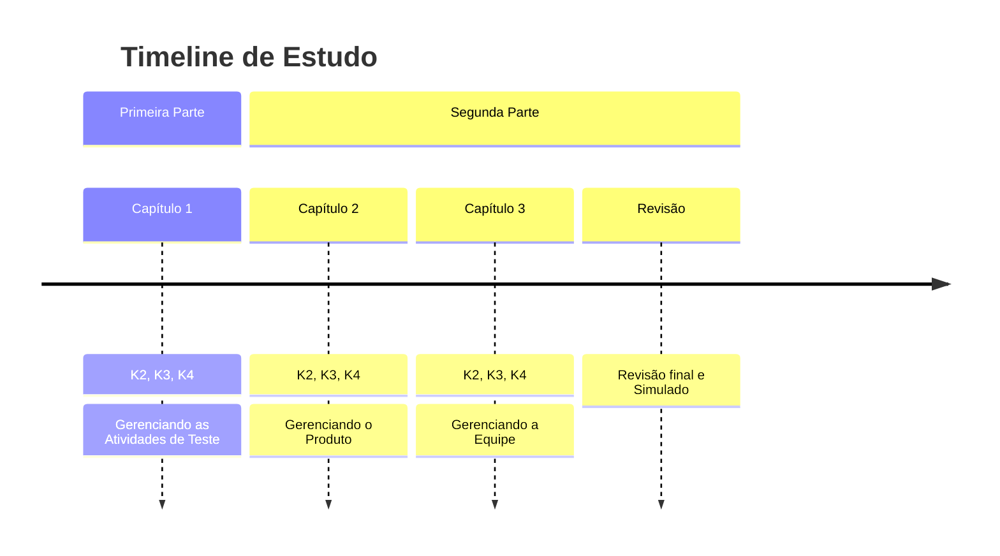

import { Referencia, Referencias } from "@site/src/components/Referencias";
import { BarChart, DataTable } from "@gabrioliv/dossier";
import { ptBR } from "@gabrioliv/dossier/locales/pt-BR";

# Certified Tester Advanced Level, Test Management

CTAL-TM é uma certificação reconhecida internacionalmente para profissionais de qualidade de software e teste de software. É oferecida pela ISTQB (International Software Testing Qualifications Board) e aborda o gerenciamento de testes. É uma certificação de nível avançado e tem a CTFL como pré-requisito.

A seguir, você encontrará a documentação criada como resumo de estudo para a certificação CTAL-TM.
A única base utilizada para a criação deste material foi o Syllabus da CTAL-TM 3.0, portanto, é recomendado que você consulte o documento oficial para obter informações mais detalhadas.

Consegui a certificação CTAL-TM em 14/09/2026 e resolvi compartilhar o material que criei para estudar.

## Capítulos

- [Capítulo 1: Gerenciando as Atividades de Teste](./ctal-tm/ctaltm_01)
- [Capítulo 2: Gerenciando o Produto](./ctal-tm/ctaltm_02)
- [Capítulo 3: Gerenciando a Equipe](./ctal-tm/ctaltm_03)

## Como estudar com este resumo

Cada subseção começa com o objetivo de aprendizagem do syllabus (código e nível K). O nível diz como o tema é cobrado:

- **K2 (Compreensão):** explicar, comparar, dar exemplos. A questão pede reconhecer a afirmação certa.
- **K3 (Aplicação):** usar um método numa situação: SMART, retrospectiva, fluxo de defeitos, classificação de defeitos, custo-benefício.
- **K4 (Análise):** ler um cenário e escolher: atividades de gestão, mitigação de riscos, abordagem de teste, plano de ferramentas, relatório, técnica de estimativa, habilidades da equipe.

## Peso de cada capítulo

O tempo de estudo que o syllabus dá a cada capítulo indica onde está a maior parte da prova.

<BarChart
  title="Tempo de estudo por capítulo"
  labels={ptBR.BarChart}
  unit="min"
  format={(v) => v.toLocaleString("pt-BR")}
  data={[
    { label: "Cap. 1 Atividades de Teste", value: 750, active: true },
    { label: "Cap. 2 Produto", value: 390 },
    { label: "Cap. 3 Equipe", value: 225 },
  ]}
/>

<DataTable
  caption="Objetivos de aprendizagem por nível K"
  columns={[
    { key: "cap", label: "Capítulo" },
    { key: "k2", label: "K2", numeric: true },
    { key: "k3", label: "K3", numeric: true },
    { key: "k4", label: "K4", numeric: true },
    { key: "total", label: "Total", numeric: true },
  ]}
  rows={[
    { cap: "1 Gerenciando as Atividades de Teste", k2: 22, k3: 2, k4: 4, total: 28 },
    { cap: "2 Gerenciando o Produto", k2: 8, k3: 2, k4: 2, total: 12 },
    { cap: "3 Gerenciando a Equipe", k2: 6, k3: 1, k4: 1, total: 8 },
    { cap: "Total", k2: 36, k3: 5, k4: 7, total: 48 },
  ]}
  highlightRows={[3]}
/>

## Fluxo de Estudo

## Referências

<Referencias>

<Referencia tipo="Referência">

Syllabus CTAL-TM 3.0 (BSTQB pt_BR) — Utilizado para a criação deste material.

</Referencia>

<Referencia tipo="Referência">

Syllabus CTAL-TM 3.0 (ISTQB en) — Documento oficial da ISTQB, utilizado para desambiguação de termos.

</Referencia>

<Referencia tipo="Referência">

MermaidJS — Utilizado para a criação de diagramas no markdown.

</Referencia>

<Referencia tipo="Referência">

As demais bibliografias já estão referenciadas adequadamente nos Syllabus.

</Referencia>

</Referencias>

---
