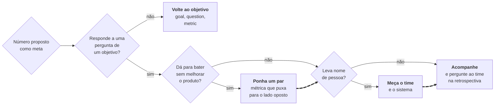

import { Referencia, Referencias } from "@site/src/components/Referencias";
import { Comparison, DataTable, Quote, Timeline } from "@gabrioliv/dossier";

# Cobra Effect e Lei de Goodhart

_Métricas de testes sem caça às bruxas_

{frontMatter.description}

---

Em 1902, Hanói, capital da Indochina Francesa, tinha medo da peste, e os esgotos recém-construídos pela administração colonial tinham virado casa para os ratos. A prefeitura contratou caçadores e, quando o trabalho rendeu menos que o esperado, abriu a caça aos moradores: um centavo por rato morto. Como ninguém queria lidar com milhares de cadáveres, bastava entregar o rabo. Logo os funcionários começaram a ver ratos vivos e sem rabo andando pela cidade. Os caçadores pegavam o animal, cortavam a cauda, recebiam o centavo e soltavam o rato de volta no esgoto, onde ele continuava se reproduzindo. Houve até quem criasse ratos nos arredores para vender os rabos. O historiador Michael Vann reconstruiu o episódio a partir dos arquivos coloniais franceses[^1].

Se você trabalha com qualidade de software, já viu um rabo sem rato. O painel mostra 85% de cobertura, e o primeiro defeito que chega da produção estava numa linha coberta por um teste que não conferia nada. Ou a sprint termina com recorde de bugs abertos, e metade deles é a mesma falha registrada cinco vezes.

O economista alemão Horst Siebert deu nome a esse padrão em 2001, no livro _Der Kobra-Effekt_[^2]. O nome vem de uma história passada em Délhi no tempo do domínio britânico. O governo, preocupado com as cobras da cidade, pagava por cada uma morta. Gente esperta passou a criar cobras para receber a recompensa, o governo descobriu e cancelou o programa, e os criadores soltaram os animais, que já não valiam nada. A cidade terminou com mais cobras do que tinha no começo. Ninguém achou documento que comprove a versão indiana, e o caso de Hanói é o que tem arquivo. Em economia, o efeito cobra descreve o incentivo que alimenta o problema que deveria resolver.

Em 1975, numa conferência do Banco Central da Austrália, o economista britânico Charles Goodhart, então conselheiro do Banco da Inglaterra, explicou por que o governo do Reino Unido não conseguia controlar a inflação mirando a quantidade de dinheiro em circulação[^3]: as relações estatísticas entre esse agregado e a inflação se desfaziam assim que o governo passava a usá-las como alvo. Goodhart resumiu o problema numa frase que, segundo ele mesmo, era para ser uma piada de passagem.

<Quote source="Charles Goodhart, Problems of Monetary Management: The U.K. Experience (1975), em tradução livre">
  Qualquer regularidade estatística observada tende a desmoronar assim que se faz pressão sobre ela para fins de controle.
</Quote>

A versão que circula hoje é da antropóloga Marilyn Strathern. Em 1997, num artigo sobre a auditoria das universidades britânicas[^4], ela escreveu que, quando uma medida vira meta, deixa de ser uma boa medida. O psicólogo social Donald Campbell tinha chegado a uma conclusão parecida olhando para indicadores de políticas públicas[^5]: quanto mais um indicador quantitativo é usado para tomar decisões sociais, mais sujeito fica a pressões de corrupção e mais tende a distorcer o processo que deveria acompanhar. Goodhart fala do número que perde o significado, e o efeito cobra fala do mundo que piora por causa do número. Em software, um costuma vir junto com o outro.

<Timeline
  events={[
    { at: "1902", label: "Hanói", note: "um centavo por rabo de rato" },
    { at: "1975", label: "Goodhart", note: "a regularidade que desmorona sob controle" },
    { at: "1979", label: "Campbell", note: "o indicador que corrompe o que mede" },
    { at: "1997", label: "Strathern", note: "a medida que vira meta", active: true },
    { at: "2001", label: "Siebert", note: "Der Kobra-Effekt dá nome ao padrão" },
  ]}
/>

Qualidade de software não cabe num número. Ela é o app que não cobra o cliente duas vezes e o código que alguém consegue mudar numa sexta à tarde sem medo. Como ninguém consegue medir isso direto, o time mede coisas vizinhas: cobertura, defeitos encontrados, tempo de correção. Cada métrica é um indicador indireto, o que a estatística chama de _proxy_. Enquanto ninguém ganha nem perde nada com ela, o número acompanha a qualidade de perto. Quando entra na avaliação de desempenho, no bônus ou no slide da diretoria, ele vira incentivo, e as pessoas passam a ter dois jeitos de mexer nele: melhorar o produto ou melhorar o número. O segundo costuma sair mais barato.

Júlia lidera o time de QA de um app de entrega de comida. No semestre passado, o app cobrou pedidos em dobro duas vezes, e a diretoria chegou ao planejamento do trimestre com três metas: 80% de cobertura de testes automatizados, zero bugs críticos em produção e um ranking mensal de defeitos encontrados por testador. As três parecem razoáveis, e cada uma responde a uma dor real.

O painel melhora já nas primeiras semanas. Uma tela de pagamento com cinco validações quebradas, que antes virava um defeito com cinco itens, agora vira cinco defeitos. Os testadores param de sentar com o desenvolvedor para resolver o problema na hora, porque defeito corrigido na conversa não entra no ranking. Os desenvolvedores, que veem o próprio nome ao lado de cada defeito, passam a contestar todos. A reunião de triagem gasta mais tempo discutindo a severidade do que a correção: uma falha de pagamento com uma bandeira de cartão vira "alta", e não "crítica", porque afeta só 3% dos pedidos. E a cobertura sobe com testes que chamam funções sem conferir o resultado.

Cada uma dessas decisões dá para defender numa reunião, e quase ninguém no time acha que está trapaceando. O estrago maior vem quando o número passa a servir para achar culpado. W. Edwards Deming, o estatístico americano que ensinou controle de qualidade à indústria japonesa depois da Segunda Guerra, pôs dois pontos sobre isso na lista de catorze do livro _Out of the Crisis_, de 1986: expulsar o medo da organização e eliminar a gestão por números e metas numéricas[^6]. Uma métrica usada para punir ensina as pessoas a esconder a má notícia, e em QA a má notícia é o produto do trabalho.

A cobertura de código é o exemplo mais estudado. Martin Fowler escreveu em 2012 que, quando um nível de cobertura vira meta, as pessoas vão atrás dele, e que números altos são fáceis demais de alcançar com testes de baixa qualidade[^7]. Dois anos depois, Laura Inozemtseva e Reid Holmes mediram isso em cinco sistemas Java grandes[^8]. Eles geraram milhares de suítes de teste, inseriram defeitos artificiais no código (o chamado teste de mutação, tema da nota [Testes de Mutação](./testes_mutacao)) e contaram quantos cada suíte detectava. Com o tamanho da suíte mantido constante, a correlação entre cobertura e capacidade de achar defeitos ficou entre baixa e moderada. A cobertura aponta bem o código que nenhum teste executa, como mostra a nota sobre [Cobertura de Testes](./test_coverage_sdlc), mas diz pouco sobre quanto os testes protegem. O mesmo vale para a taxa de aprovação da suíte, que sobe quando alguém desliga os testes instáveis, e para o tempo de fechamento de defeito, que cai quando ele é fechado como "não reproduz".

<DataTable
  caption="Métricas comuns de QA e como cada uma se bate sem melhorar o produto"
  columns={[
    { key: "m", label: "Métrica" },
    { key: "q", label: "O que pretende medir" },
    { key: "b", label: "Como se bate sem melhorar" },
    { key: "c", label: "Pergunta que equilibra" },
  ]}
  rows={[
    { m: "Cobertura de código", q: "Quanto do código os testes exercitam", b: "Testes que executam linhas sem conferir o resultado", c: "Quantos defeitos injetados a suíte pega?" },
    { m: "Defeitos por testador", q: "Eficácia de quem testa", b: "Um defeito partido em cinco, defeitos triviais", c: "Quantos defeitos escaparam para a produção?" },
    { m: "Zero bugs críticos", q: "Estabilidade para o cliente", b: "Severidade rebaixada na triagem", c: "O que o suporte e a loja de apps estão dizendo?" },
    { m: "Taxa de aprovação da suíte", q: "Saúde da build", b: "Testes instáveis desligados ou apagados", c: "Quantos testes estão em quarentena, e desde quando?" },
    { m: "Casos executados", q: "Esforço de teste", b: "Casos repetidos ou partidos", c: "Que riscos esses casos cobrem?" },
    { m: "Tempo para fechar defeito", q: "Agilidade de correção", b: "Fechar como não reproduz ou duplicado", c: "Quantos defeitos são reabertos?" },
  ]}
/>

No fim do trimestre, o painel de Júlia está verde: 82% de cobertura, nenhum bug crítico registrado, ranking com recorde de defeitos. No mesmo período, a nota do app na loja caiu e o suporte recebeu uma onda de reclamações de cupons aplicados duas vezes, um defeito que tinha sido classificado como "médio" em março. Enquanto o time gasta energia no número, o risco fica sem dono. O painel esconde esse risco de quem decide, que vê verde e corta investimento em teste. E o canal entre quem testa e quem desenvolve entope, porque reportar um defeito virou briga.

No trimestre seguinte, a diretoria percebe o problema e derruba o ranking. Então aparecem as cobras soltas. Os mil e quatrocentos testes sem verificação continuam na suíte, somando vinte minutos a cada execução do _pipeline_, e ninguém sabe quais deles protegem alguma coisa. Os defeitos rebaixados continuam no _backlog_ com a severidade errada, e os testadores aprenderam que abrir defeito custa uma discussão.

<Figure title="O PAINEL E O PRODUTO">
  
</Figure>

Sem número nenhum, a conversa sobre qualidade vira opinião contra opinião, vencida por quem fala mais alto. A saída é escolher números difíceis de bater sem melhorar o produto. Em 1994, Victor Basili, Gianluigi Caldiera e Dieter Rombach descreveram uma abordagem chamada GQM, de _Goal, Question, Metric_[^9]. A ordem está no nome: primeiro o objetivo, depois as perguntas que dizem se ele está sendo atingido, e só então as métricas que respondem a essas perguntas. Júlia refez o exercício com a diretoria. O objetivo virou "o cliente não ser cobrado errado", e dele saíram três perguntas: quantos pedidos com cobrança errada chegam ao suporte por semana, quanto tempo o time leva para perceber e em que etapa o defeito poderia ter sido pego. As métricas saíram dessas perguntas, e nenhuma levava o nome de uma pessoa.

A segunda prática é juntar métricas que puxam para lados opostos. A pesquisa do DORA, publicada no livro _Accelerate_ por Nicole Forsgren, Jez Humble e Gene Kim em 2018[^10], mede a entrega de software com quatro números. A frequência de _deploy_ e o tempo entre o _commit_ e a produção medem velocidade. A taxa de mudanças que falham e o tempo para restaurar o serviço medem estabilidade. O time que acelera quebrando a produção aparece no painel.

<Comparison
  level={2}
  columns={[
    {
      code: "+",
      title: "Métrica para aprender",
      lead: "O número abre a conversa:",
      items: [
        "Mede o time e o sistema, nunca a pessoa",
        "Responde a uma pergunta ligada a um objetivo",
        "Vem em par com uma métrica que puxa para o lado oposto",
        "Defeito que escapou vira pergunta sobre a etapa",
      ],
      active: true,
    },
    {
      code: "−",
      title: "Métrica para punir",
      lead: "O número encerra a conversa:",
      items: [
        "Ranking individual ligado a bônus ou avaliação",
        "Meta fixa, sem pergunta por trás",
        "Um número sozinho, fácil de inflar",
        "Defeito vira acusação, e o relato some",
      ],
    },
  ]}
/>

Fowler propõe, no mesmo texto de 2012[^7], um teste que nenhum painel mostra: você tem testes suficientes se raramente escapa defeito para a produção e se raramente hesita em mudar o código por medo de quebrar alguma coisa. Os dois critérios cabem numa pergunta ao time em toda retrospectiva.

<Figure title="ANTES DE UM NÚMERO VIRAR META" full>

</Figure>

A prefeitura de Hanói pediu rabos porque ninguém queria lidar com os cadáveres, e o número fácil acabou financiando a criação de ratos. Antes de transformar um número em meta, faça a pergunta que ela não fez: se alguém quisesse bater esse número sem melhorar nada, como faria? Se a resposta vier em menos de um minuto, você está pagando por rabos. Júlia levou essa pergunta ao planejamento seguinte e trocou o ranking por uma revisão mensal dos defeitos que escaparam para a produção, sem nome de ninguém e com uma pergunta só: em que etapa dava para ter pego este?

---

## Mapa Mental

- **🐀 Os rabos de Hanói (1902)**
  - Um centavo por rato morto, pago contra a entrega do rabo
  - Ratos vivos e sem rabo soltos no esgoto para procriar
  - Criação de ratos nos arredores para vender rabos
- **🐍 Efeito Cobra**
  - Horst Siebert, Der Kobra-Effekt (2001)
  - A história de Délhi: recompensa por cobra morta, criação de cobras, soltura no fim
  - O incentivo que alimenta o problema que deveria resolver
- **📉 Lei de Goodhart**
  - Goodhart (1975): a regularidade estatística desmorona sob pressão de controle
  - Strathern (1997): quando uma medida vira meta, deixa de ser boa medida
  - Campbell: o indicador usado para decidir corrompe o processo que mede
- **🎯 Métrica, incentivo e qualidade**
  - Qualidade não cabe num número; o time mede coisas vizinhas (proxy)
  - Com bônus ou ranking, a métrica vira incentivo
  - Melhorar o número costuma sair mais barato que melhorar o produto
- **⚠️ Distorções no time de Júlia**
  - Defeito partido em cinco, severidade rebaixada, teste sem verificação
  - Deming: expulsar o medo, eliminar gestão por metas numéricas
  - Métrica que pune ensina a esconder a má notícia
- **🧪 Métricas de QA que enganam**
  - Cobertura: Fowler (2012) e Inozemtseva e Holmes (2014)
  - Defeitos por testador, zero bugs críticos, taxa de aprovação, casos executados, tempo de fechamento
- **🧯 As cobras soltas**
  - Painel verde, produto pior, risco escondido de quem decide
  - Fim da meta: testes inúteis, severidades erradas e medo de reportar ficam
- **🧭 Métricas que melhoram o produto**
  - GQM: objetivo, pergunta e só então métrica
  - DORA: velocidade em par com estabilidade
  - Fowler: poucos defeitos escapam e ninguém tem medo de mudar o código
  - Pergunta antes da meta: como alguém bateria esse número sem melhorar nada?

---

## Referências

<Referencias>

<Referencia tipo="Artigo" tema="Efeito Cobra">

Vann, M. G. (2003). Of Rats, Rice, and Race: The Great Hanoi Rat Massacre, an Episode in French Colonial History. _French Colonial History_, 4.

[https://csus.edu/indiv/v/vannm/publications.html](https://csus.edu/indiv/v/vannm/publications.html)

</Referencia>

<Referencia tipo="Livro" tema="Efeito Cobra">

Siebert, H. (2001). _Der Kobra-Effekt: Wie man Irrwege der Wirtschaftspolitik vermeidet_. Munique: Deutsche Verlags-Anstalt.

[https://en.wikipedia.org/wiki/Perverse_incentive](https://en.wikipedia.org/wiki/Perverse_incentive)

</Referencia>

<Referencia tipo="Artigo" tema="Lei de Goodhart">

Goodhart, C. A. E. (1975). Problems of Monetary Management: The U.K. Experience. _Papers in Monetary Economics_, vol. 1. Reserve Bank of Australia.

[https://en.wikipedia.org/wiki/Goodhart%27s_law](https://en.wikipedia.org/wiki/Goodhart%27s_law)

</Referencia>

<Referencia tipo="Artigo" tema="Lei de Goodhart">

Strathern, M. (1997). 'Improving ratings': audit in the British University system. _European Review_, 5(3), 305-321.

[https://www.cambridge.org/core/journals/european-review/article/improving-ratings-audit-in-the-british-university-system/FC2EE640C0C44E3DB87C29FB666E9AAB](https://www.cambridge.org/core/journals/european-review/article/improving-ratings-audit-in-the-british-university-system/FC2EE640C0C44E3DB87C29FB666E9AAB)

</Referencia>

<Referencia tipo="Artigo" tema="Lei de Campbell">

Campbell, D. T. (1979). Assessing the impact of planned social change. _Evaluation and Program Planning_, 2(1), 67-90.

[https://doi.org/10.1016/0149-7189(79)90048-X](https://doi.org/10.1016/0149-7189(79)90048-X)

</Referencia>

<Referencia tipo="Livro" tema="Gestão da Qualidade">

Deming, W. E. (1986). _Out of the Crisis_. Cambridge: MIT Center for Advanced Engineering Study.

[https://deming.org/fourteen-points](https://deming.org/fourteen-points)

</Referencia>

<Referencia tipo="Referência" tema="Cobertura de Testes">

Fowler, M. (2012). TestCoverage. _martinfowler.com_, 17 abr. 2012.

[https://martinfowler.com/bliki/TestCoverage.html](https://martinfowler.com/bliki/TestCoverage.html)

</Referencia>

<Referencia tipo="Artigo" tema="Cobertura de Testes">

Inozemtseva, L., & Holmes, R. (2014). Coverage is not strongly correlated with test suite effectiveness. _Proceedings of the 36th International Conference on Software Engineering (ICSE)_, 435-445.

[https://doi.org/10.1145/2568225.2568271](https://doi.org/10.1145/2568225.2568271)

</Referencia>

<Referencia tipo="Artigo" tema="Definição de Métricas">

Basili, V. R., Caldiera, G., & Rombach, H. D. (1994). The Goal Question Metric Approach. _Encyclopedia of Software Engineering_, 528-532.

[https://www.cs.umd.edu/~mvz/handouts/gqm.pdf](https://www.cs.umd.edu/~mvz/handouts/gqm.pdf)

</Referencia>

<Referencia tipo="Livro" tema="Métricas de Entrega">

Forsgren, N., Humble, J., & Kim, G. (2018). _Accelerate: The Science of Lean Software and DevOps_. Portland: IT Revolution Press.

[https://itrevolution.com/articles/measure-software-delivery-performance-four-key-metrics/](https://itrevolution.com/articles/measure-software-delivery-performance-four-key-metrics/)

</Referencia>

</Referencias>

[^1]: Vann, M. G. (2003). _Of Rats, Rice, and Race: The Great Hanoi Rat Massacre_. French Colonial History. [https://csus.edu/indiv/v/vannm/publications.html](https://csus.edu/indiv/v/vannm/publications.html)

[^2]: Siebert, H. (2001). _Der Kobra-Effekt_. Deutsche Verlags-Anstalt. [https://en.wikipedia.org/wiki/Perverse_incentive](https://en.wikipedia.org/wiki/Perverse_incentive)

[^3]: Goodhart, C. A. E. (1975). _Problems of Monetary Management: The U.K. Experience_. Reserve Bank of Australia. [https://en.wikipedia.org/wiki/Goodhart%27s_law](https://en.wikipedia.org/wiki/Goodhart%27s_law)

[^4]: Strathern, M. (1997). _'Improving ratings': audit in the British University system_. European Review. [https://www.cambridge.org/core/journals/european-review/article/improving-ratings-audit-in-the-british-university-system/FC2EE640C0C44E3DB87C29FB666E9AAB](https://www.cambridge.org/core/journals/european-review/article/improving-ratings-audit-in-the-british-university-system/FC2EE640C0C44E3DB87C29FB666E9AAB)

[^5]: Campbell, D. T. (1979). _Assessing the impact of planned social change_. Evaluation and Program Planning. [https://doi.org/10.1016/0149-7189(79)90048-X](https://doi.org/10.1016/0149-7189(79)90048-X)

[^6]: Deming, W. E. (1986). _Out of the Crisis_. MIT CAES. [https://deming.org/fourteen-points](https://deming.org/fourteen-points)

[^7]: Fowler, M. (2012). _TestCoverage_. martinfowler.com. [https://martinfowler.com/bliki/TestCoverage.html](https://martinfowler.com/bliki/TestCoverage.html)

[^8]: Inozemtseva, L., & Holmes, R. (2014). _Coverage is not strongly correlated with test suite effectiveness_. ICSE. [https://doi.org/10.1145/2568225.2568271](https://doi.org/10.1145/2568225.2568271)

[^9]: Basili, V. R., Caldiera, G., & Rombach, H. D. (1994). _The Goal Question Metric Approach_. [https://www.cs.umd.edu/~mvz/handouts/gqm.pdf](https://www.cs.umd.edu/~mvz/handouts/gqm.pdf)

[^10]: Forsgren, N., Humble, J., & Kim, G. (2018). _Accelerate_. IT Revolution. [https://itrevolution.com/articles/measure-software-delivery-performance-four-key-metrics/](https://itrevolution.com/articles/measure-software-delivery-performance-four-key-metrics/)

---
