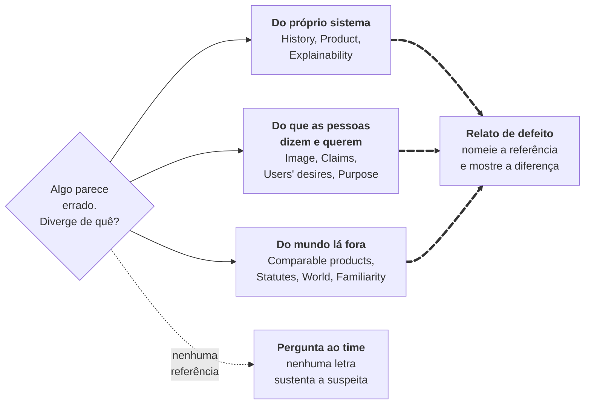

import { Referencia, Referencias } from "@site/src/components/Referencias";
import { Comparison, DataTable, Quote, Timeline } from "@gabrioliv/dossier";

# Heurística FEW HICCUPPS

_Como ampliar a visão de QA sobre consistência em testes usando um mnemônico_

{frontMatter.description}

---

Um detetive chega a um apartamento furtado e encontra a janela aberta. Sozinha, a janela diz pouco: pode ter sido o ladrão, pode ter sido o calor. Ele cruza essa pista com o resto do caso. O porteiro jura que ninguém subiu depois das dez. O histórico do prédio registra dois arrombamentos pela mesma escada de incêndio. A poeira do parapeito está intacta, e choveu forte a noite inteira, o que torna estranho alguém ter deixado a janela aberta. A suspeita ganha corpo quando um depoimento contradiz uma pista, ou quando a circunstância não combina com o histórico.

Se você testa software, já esteve no lugar desse detetive com uma pista só. Você encontra um comportamento esquisito, abre o defeito e a resposta chega em dez minutos: "isso não está no requisito". O requisito de fato não fala do assunto. Você tem certeza de que algo está errado, mas tratou o requisito como a única testemunha do caso e não tem outra para chamar.

Marina é testadora num banco digital e recebeu a história de usuário da nova exportação de extrato. A história tem uma frase: o cliente pode exportar o extrato de um período em CSV, o formato de texto que as planilhas abrem. Ela escolhe março, toca no botão e o arquivo baixa. O critério de aceite está cumprido. Quando ela abre o arquivo na planilha, o cabeçalho aparece como <b style={{ color: "var(--ds-contrast-error)" }}>descrição</b>, os valores vêm com ponto no lugar da vírgula e há um Pix agendado para 31 de abril. Nenhuma dessas coisas contradiz a frase da história.

Para situações assim, James Bach montou uma lista de perguntas, e Michael Bolton a publicou em 2005 no artigo _Testing Without a Map_[^1], da revista _Better Software_. Os dois são autores do _Rapid Software Testing_[^2], uma metodologia para testar sob incerteza e pressão de prazo. A lista virou o mnemônico HICCUPP, sete letras para sete coisas com as quais um produto deve ser coerente: _History_, _Image_, _Comparable products_, _Claims_, _User expectations_, _Product_ e _Purpose_. Depois os dois acrescentaram o S de _Statutes_, as leis, que mais tarde passou a cobrir também as normas técnicas. Em julho de 2012, Bolton reuniu tudo no post FEW HICCUPPS[^3], com mais três letras na frente: _Familiarity_, _Explainability_ e _World_. Em 2014 ele trocou as expectativas do usuário por desejos do usuário. Lido em voz alta, o nome soa como _few hiccups_, poucos soluços.

<Timeline
  events={[
    { at: "1982", label: "Weyuker", note: "programas sem oráculo" },
    { at: "1988", label: "Kaner", note: "o termo teste exploratório em livro" },
    { at: "2005", label: "HICCUPP", note: "Testing Without a Map, de Bolton" },
    { at: "2012", label: "FEW HICCUPPS", note: "onze letras no blog de Bolton", active: true },
    { at: "2015", label: "Barr et al.", note: "o problema do oráculo revisado" },
  ]}
/>

Cada letra funciona como um oráculo. Em teste, oráculo é aquilo que diz se um resultado está certo ou errado: uma especificação, uma tabela de valores esperados, a versão antiga do sistema, a cabeça de quem conhece o negócio. Em 1982, a cientista da computação Elaine Weyuker publicou _On Testing Non-Testable Programs_[^4], em que chama de não testável o programa sem oráculo, ou aquele em que conferir a saída custa um esforço fora do comum. Em 2015, Earl Barr e colegas revisaram a pesquisa sobre o tema num levantamento da _IEEE Transactions on Software Engineering_[^5] e chamaram de problema do oráculo a dificuldade de separar, para uma entrada dada, o comportamento correto do comportamento possivelmente errado.

Marina vive esse problema toda semana, porque a única especificação dela é uma frase. Bach e Bolton trabalham com um oráculo menos exigente: no post de 2012[^3], oráculo é um jeito de reconhecer um problema. Ele não precisa saber qual é a resposta certa. Basta perceber que o produto está incoerente com alguma coisa que importa, e a sigla lista onze dessas coisas. Bolton avisa que todas podem falhar.

<Quote source="Michael Bolton, FEW HICCUPPS (2012), em tradução livre">
  Princípios de oráculo são, como toda heurística, falíveis e dependentes de contexto; para serem aplicados, e não seguidos.
</Quote>

Heurística, nesse sentido, é um atalho para decidir que acerta na maior parte das vezes e às vezes erra. Uma incoerência levanta a suspeita de problema. Quem confirma é a conversa com o time.

Volte ao arquivo de Marina com a sigla na mão. Ajuda ler as onze letras em três grupos: o sistema comparado consigo mesmo, com o que as pessoas dizem e querem, e com o mundo lá fora. Pelo histórico (_History_), a versão anterior do app ordenava as transações da mais recente para a mais antiga, e o arquivo novo faz o contrário. Pelo próprio produto (_Product_), a tela de extrato mostra 1.234,56 e o arquivo mostra 1234.56. Pela explicabilidade (_Explainability_), o saldo final não bate com a soma das linhas e ninguém do time sabe dizer por quê. Pela imagem (_Image_), um banco que entrega ao cliente um arquivo chamado export_final_v2.csv parece improvisado. As alegações (_Claims_) incluem o que pessoas importantes disseram, por escrito ou em conversa, e a central de ajuda promete extrato de até doze meses enquanto o app aceita noventa dias. Pelos desejos do usuário (_Users' desires_) e pelo propósito (_Purpose_), quem exporta extrato quer abrir na planilha, conferir gastos e declarar imposto, e o arquivo atrapalha as três coisas.

<Figure title="UMA OBSERVAÇÃO, ONZE REFERÊNCIAS">
  
</Figure>

As letras restantes olham para fora do sistema. Pelos produtos comparáveis (_Comparable products_), o extrato de outros bancos abre certo na mesma planilha. Pelas leis e normas (_Statutes_), a RFC 4180[^6], o documento que descreve o formato CSV, pede aspas em volta de campo que contém vírgula, e a linha "MERCADO, CENTRO" saiu sem aspas e quebrou em duas colunas. Pelo mundo (_World_), abril tem trinta dias. A familiaridade (_Familiarity_) funciona ao contrário das outras: ela pede que o produto seja incoerente com padrões de problemas conhecidos, e <b style={{ color: "var(--ds-contrast-error)" }}>descrição</b> é um defeito velho, o de um arquivo gravado numa codificação de caracteres e lido em outra.

<DataTable
  caption="As onze letras e o extrato de Marina"
  columns={[
    { key: "l", label: "Letra" },
    { key: "c", label: "O produto deve ser coerente com" },
    { key: "e", label: "No extrato" },
  ]}
  rows={[
    { l: "F · Familiarity", c: "Ao contrário: deve fugir de padrões de problemas conhecidos", e: "Acento quebrado por codificação trocada" },
    { l: "E · Explainability", c: "Uma explicação que o time consiga dar", e: "Saldo final que ninguém explica" },
    { l: "W · World", c: "O que se sabe ou se observa do mundo", e: "Pix agendado para 31 de abril" },
    { l: "H · History", c: "Versões anteriores do próprio sistema", e: "Ordem das transações invertida" },
    { l: "I · Image", c: "A imagem que a empresa quer passar", e: "Arquivo export_final_v2.csv" },
    { l: "C · Comparable products", c: "Produtos parecidos, da casa ou concorrentes", e: "Extrato de outro banco abre certo" },
    { l: "C · Claims", c: "O que pessoas importantes dizem e escrevem", e: "Ajuda promete doze meses, app aceita noventa dias" },
    { l: "U · Users' desires", c: "O que usuários razoáveis querem", e: "Abrir na planilha sem ajustar nada" },
    { l: "P · Product", c: "Elementos parecidos do mesmo produto", e: "Tela com vírgula decimal, arquivo com ponto" },
    { l: "P · Purpose", c: "Os usos explícitos e implícitos do produto", e: "Conferir gastos e declarar imposto" },
    { l: "S · Statutes", c: "Leis e normas que se aplicam", e: "Campo com vírgula sem aspas (RFC 4180)" },
  ]}
/>

A sigla também serve antes de existir arquivo para abrir. Na elaboração de casos de teste, o ponto fraco costuma ser o resultado esperado: quando o requisito é uma frase, o caso herda só aquela frase. Cada letra vira uma pergunta que gera condições de teste e resultados esperados onde o requisito se cala. O que a versão anterior fazia com o mesmo período? O que a central de ajuda, o material de marketing e as notas de versão prometem? Como o extrato do concorrente lida com um Pix de descrição longa? Marina escreveu um caso só para comparar a soma das linhas com o saldo da tela, e outro para exportar um mês com transações perto da meia-noite. No campo de resultado esperado, ela anota a letra que justifica o valor, e quem revisar o caso sabe de onde veio a expectativa. Quem já usa teste baseado em lista de verificação, técnica que a CTFL[^7] descreve no [capítulo 4](../istqb/ctfl/ctfl_04.mdx), pode começar a lista pelas onze letras.

O ganho maior aparece no teste exploratório. O termo foi publicado por Cem Kaner no livro _Testing Computer Software_[^8], de 1988, e a CTFL[^7] o descreve como teste em que modelagem, execução e avaliação acontecem ao mesmo tempo. Sem roteiro, o testador decide a cada passo o que olhar e precisa decidir na hora se o que viu é problema, justo onde o requisito ajuda menos. Marina abre uma sessão com uma missão curta, explorar a exportação como quem vai declarar imposto, e usa as letras para destravar quando a sessão empaca: já comparei com a versão anterior, com a tela, com o concorrente? Quando acha algo, o relato sai diferente. Em vez de "o valor está estranho", ela escreve que o arquivo é incoerente com a tela de extrato do próprio app e anexa as duas imagens lado a lado. O desenvolvedor que respondeu "isso não está no requisito" agora tem uma referência concreta para discutir, e pode até concordar.

<Figure title="DIVERGE DE QUÊ?" full>

</Figure>

A sigla dá nome à intuição, amplia o que conta como referência além do requisito e deixa o relato de defeito mais difícil de descartar. Os limites estão no próprio post de 2012[^3]. Oráculos podem enganar, fazendo você enxergar um problema que não existe ou deixar passar um que existe. A letra W falha quando o que sabemos do mundo está errado, e começar pelos problemas conhecidos é rápido mas também pode enganar. As letras ainda brigam entre si: pelo histórico, a ordem antiga das transações era a certa, mas talvez a central de ajuda sempre tenha prometido a ordem nova e o defeito fosse a versão anterior. Algumas pedem conhecimento que o testador nem sempre tem, como o jeito que o concorrente exporta o extrato ou a norma que vale para o arquivo. E Bolton diz que a lista não é completa.

<Comparison
  columns={[
    {
      code: "+",
      title: "O que a sigla dá",
      lead: "Para quem testa:",
      items: [
        "Referências além do requisito escrito",
        "Nome para a intuição de que algo está errado",
        "Relato de defeito que aponta a fonte da expectativa",
        "Varredura para destravar uma sessão exploratória",
      ],
      active: true,
    },
    {
      code: "−",
      title: "Onde ela falha",
      lead: "Segundo o próprio Bolton e na prática:",
      items: [
        "Oráculos enganam, nos dois sentidos",
        "Letras se contradizem e alguém precisa decidir",
        "Comparable e Statutes exigem conhecer mercado e normas",
        "A lista não é completa",
        "Vira burocracia se for checada inteira em todo caso",
      ],
    },
  ]}
/>

O desafio prático é não transformar a sigla em formulário. Onze perguntas obrigatórias por caso de teste viram burocracia em uma semana, e Bolton pede que os princípios sejam aplicados, e não seguidos. Escolha as letras que o risco da funcionalidade pede. Num extrato bancário, _Claims_ e _Statutes_ pesam mais que _Image_. Numa página de campanha de marketing, talvez seja o contrário.

O detetive do começo não acusou ninguém por causa de uma janela aberta. Ele foi atrás do porteiro, do histórico do prédio e da poeira no parapeito. Na próxima vez que algo parecer estranho num teste, antes de escrever "acho que está errado", pergunte estranho em relação a quê. Cada letra é uma testemunha que você pode chamar: a versão anterior, a central de ajuda, o banco concorrente, o calendário. Se uma delas contradiz o que o software fez, ela entra no relato junto com a evidência. Se nenhuma sustenta a suspeita, leve a dúvida ao time como pergunta antes de abrir o defeito.

---

## Mapa Mental

- **🕵️ O detetive e a janela aberta**
  - Uma pista sozinha não fecha o caso
  - Depoimentos, histórico, pistas e circunstâncias cruzados
  - "Isso não está no requisito": a intuição sem nome perde a discussão
- **🗺️ Origem do mnemônico**
  - James Bach monta a lista, Michael Bolton publica em Testing Without a Map (2005)
  - HICCUPP: sete letras; depois o S de Statutes, leis e normas
  - FEW HICCUPPS (2012): Familiarity, Explainability, World
  - 2014: expectativas do usuário viram desejos do usuário
- **🔮 Oráculos de teste**
  - Weyuker (1982): programa sem oráculo é não testável
  - Barr et al. (2015): o problema do oráculo
  - Bolton: oráculo é um jeito de reconhecer um problema
  - Heurística: falível, dependente de contexto, para aplicar e não seguir
- **🧭 Três grupos de coerência**
  - O sistema consigo mesmo: History, Product, Explainability
  - As pessoas: Image, Claims, Users' desires, Purpose
  - O mundo: Comparable products, Statutes, World
  - Familiarity ao contrário: fugir de problemas conhecidos
- **📝 Casos de teste**
  - Cada letra vira pergunta que gera condição e resultado esperado
  - Anotar a letra que justifica o resultado esperado
  - Ponto de partida para teste baseado em lista de verificação
- **🔍 Teste exploratório**
  - Kaner (1988): modelar, executar e avaliar ao mesmo tempo
  - As letras destravam a sessão quando ela empaca
  - Relato que nomeia a referência e mostra a diferença
- **⚖️ Limites**
  - Oráculos enganam nos dois sentidos
  - Letras se contradizem
  - Exigem conhecimento de mercado e de normas
  - Lista incompleta; vira burocracia se aplicada inteira
- **❓ Estranho em relação a quê?**
  - Uma letra encontrada: vai para o relato com a evidência
  - Nenhuma letra: vira pergunta ao time

---

## Referências

<Referencias>

<Referencia tipo="Referência" tema="Heurísticas de Consistência">

Bolton, M. (2012). FEW HICCUPPS. _DevelopSense Blog_, 23 jul. 2012, revisado em 2016 e 2017.

[https://developsense.com/blog/2012/07/few-hiccupps](https://developsense.com/blog/2012/07/few-hiccupps)

</Referencia>

<Referencia tipo="Artigo" tema="Heurísticas de Consistência">

Bolton, M. (2005). Testing Without a Map. _Better Software_, janeiro de 2005.

[https://www.satisfice.com/download/testing-without-a-map](https://www.satisfice.com/download/testing-without-a-map)

</Referencia>

<Referencia tipo="Referência" tema="Rapid Software Testing">

DevelopSense. About Michael Bolton. Página do autor, com a descrição do Rapid Software Testing.

[https://developsense.com/about-michael-bolton](https://developsense.com/about-michael-bolton)

</Referencia>

<Referencia tipo="Artigo" tema="Oráculo de Teste">

Weyuker, E. J. (1982). On Testing Non-Testable Programs. _The Computer Journal_, 25(4), 465-470.

[https://doi.org/10.1093/comjnl/25.4.465](https://doi.org/10.1093/comjnl/25.4.465)

</Referencia>

<Referencia tipo="Artigo" tema="Oráculo de Teste">

Barr, E. T., Harman, M., McMinn, P., Shahbaz, M., & Yoo, S. (2015). The Oracle Problem in Software Testing: A Survey. _IEEE Transactions on Software Engineering_, 41(5), 507-525.

[https://doi.org/10.1109/TSE.2014.2372785](https://doi.org/10.1109/TSE.2014.2372785)

</Referencia>

<Referencia tipo="Livro" tema="Teste Exploratório">

Kaner, C. (1988). _Testing Computer Software_. TAB Books.

[https://en.wikipedia.org/wiki/Exploratory_testing](https://en.wikipedia.org/wiki/Exploratory_testing)

</Referencia>

<Referencia tipo="Referência" tema="Teste Exploratório">

**ISTQB.** Certified Tester Foundation Level (CTFL) Syllabus v4.0. International Software Testing Qualifications Board, 2023.

[https://www.istqb.org/certifications/certified-tester-foundation-level-ctfl-v4-0/](https://www.istqb.org/certifications/certified-tester-foundation-level-ctfl-v4-0/)

</Referencia>

<Referencia tipo="Referência" tema="Formato CSV">

Shafranovich, Y. (2005). RFC 4180: Common Format and MIME Type for Comma-Separated Values (CSV) Files. IETF.

[https://www.rfc-editor.org/rfc/rfc4180](https://www.rfc-editor.org/rfc/rfc4180)

</Referencia>

</Referencias>

[^1]: Bolton, M. (2005). _Testing Without a Map_. Better Software. [https://www.satisfice.com/download/testing-without-a-map](https://www.satisfice.com/download/testing-without-a-map)

[^2]: DevelopSense. _About Michael Bolton_. [https://developsense.com/about-michael-bolton](https://developsense.com/about-michael-bolton)

[^3]: Bolton, M. (2012). _FEW HICCUPPS_. DevelopSense Blog. [https://developsense.com/blog/2012/07/few-hiccupps](https://developsense.com/blog/2012/07/few-hiccupps)

[^4]: Weyuker, E. J. (1982). _On Testing Non-Testable Programs_. The Computer Journal. [https://doi.org/10.1093/comjnl/25.4.465](https://doi.org/10.1093/comjnl/25.4.465)

[^5]: Barr, E. T. et al. (2015). _The Oracle Problem in Software Testing: A Survey_. IEEE TSE. [https://doi.org/10.1109/TSE.2014.2372785](https://doi.org/10.1109/TSE.2014.2372785)

[^6]: Shafranovich, Y. (2005). _RFC 4180: Common Format and MIME Type for CSV Files_. IETF. [https://www.rfc-editor.org/rfc/rfc4180](https://www.rfc-editor.org/rfc/rfc4180)

[^7]: ISTQB. _Certified Tester Foundation Level (CTFL) Syllabus v4.0_. [https://www.istqb.org/certifications/certified-tester-foundation-level-ctfl-v4-0/](https://www.istqb.org/certifications/certified-tester-foundation-level-ctfl-v4-0/)

[^8]: Kaner, C. (1988). _Testing Computer Software_. TAB Books. [https://en.wikipedia.org/wiki/Exploratory_testing](https://en.wikipedia.org/wiki/Exploratory_testing)

---
