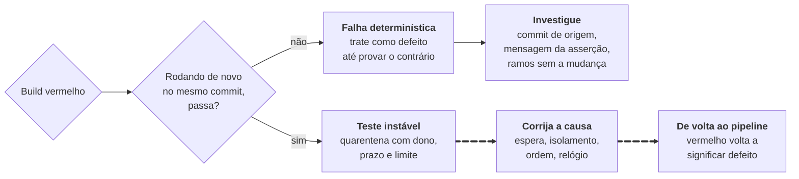

import { Referencia, Referencias } from "@site/src/components/Referencias";
import { Comparison, DataTable, Quote, Timeline } from "@gabrioliv/dossier";

# Flakiness e Efeito Nocebo

_Quando tudo é urgente, nada é urgente: como flaky tests e falsos positivos transformam alertas de qualidade em ruído e destroem a confiança na qualidade._

{frontMatter.description}

---

Em Londres, sessenta pessoas que tinham largado as estatinas por causa de dor muscular aceitaram tentar de novo. Cada uma recebeu doze frascos, um para cada mês do ano. Quatro tinham a estatina, quatro tinham comprimidos de açúcar com a mesma cara e quatro estavam vazios. Nos meses de comprimido, ninguém sabia qual era qual, e todo dia os participantes davam uma nota para os próprios sintomas num aplicativo de celular. No fim, a equipe do Imperial College comparou as notas: 90% do incômodo que as pessoas sentiam tomando a estatina também aparecia nos meses de comprimido de açúcar[^1]. A dor era real. O que a causava, na maior parte, era a expectativa de que o remédio faria mal.

Se você trabalha com testes automatizados, já viu essa expectativa decidir o diagnóstico antes da investigação. O _pipeline_ fica vermelho, alguém olha o nome do teste e diz "esse aí é instável, roda de novo". Ninguém abre o log. A segunda execução passa, o _merge_ entra e a vida segue.

Imagine o Bruno, desenvolvedor do time de checkout de uma loja online. Na suíte de testes ponta a ponta dele existe um teste que paga um pedido com Pix e confere se o pedido muda para "pago". O banco confirma o pagamento por um _webhook_, uma chamada que chega ao sistema da loja alguns instantes depois, e o teste espera dois segundos fixos antes de conferir o status. Quase sempre dá tempo. Às vezes o _webhook_ demora mais, o teste olha cedo demais e falha.

Esse é um teste _flaky_, ou instável. O Google define assim: um teste que passa e falha com o mesmo código[^2]. Muitas vezes o problema mora no próprio teste ou no ambiente, e o código testado está correto. Num levantamento publicado em 2016, John Micco contou que cerca de 1,5% de todas as execuções de teste da empresa terminavam com um resultado instável, e que quase 16% dos testes mostravam algum grau de instabilidade.

A falha do teste do Pix é um falso positivo. No teste, o resultado positivo é o que acusa um defeito. O glossário do ISTQB, a organização que mantém as certificações de teste de software, chama de falso positivo o resultado que indica um defeito que não existe, e de falso negativo o resultado que não detecta um defeito que existe[^3]. Cada vez que um teste _flaky_ falha sem defeito no código, ele produz um falso positivo. O falso negativo é o verde que mente, e costuma aparecer quando o teste não confere o que deveria (a nota sobre [Testes de Mutação](./testes_mutacao) mostra como medir isso).

<Comparison
  columns={[
    {
      code: "FP",
      title: "Falso positivo",
      lead: "O teste acusa um defeito que não existe:",
      items: [
        "Build vermelho com o código correto",
        "A falha espúria de um teste flaky entra aqui",
        "Custa investigação e, com o tempo, atenção",
      ],
      active: true,
    },
    {
      code: "FN",
      title: "Falso negativo",
      lead: "O teste não detecta um defeito que existe:",
      items: [
        "Build verde com o código quebrado",
        "Aparece quando o teste não confere o que deveria",
        "O defeito chega à produção sem nenhum aviso",
      ],
    },
  ]}
/>

O falso positivo parece o mais barato dos dois, porque ninguém sai prejudicado de imediato. O preço chega aos poucos, pela expectativa que ele cria. O termo nocebo foi proposto em 1961 pelo médico Walter Kennedy[^4], como o par do placebo. Placebo vem do latim "vou agradar"; nocebo, "vou fazer mal". O nocebo é a piora causada pela expectativa de piora. No SAMSON, como o estudo de Londres foi batizado, a estatina tinha fama de causar dor muscular, os participantes já tinham sentido essa dor, e o corpo deles respondia ao frasco que podia ser o remédio.

Com o time do Bruno aconteceu algo parecido. Depois de dezenas de falsos positivos, o teste do Pix ganhou fama, e a fama passou a ler o resultado. Um vermelho naquele teste já chegava classificado como ruído. A analogia tem um limite: no nocebo o sintoma é produzido pela expectativa, e no _pipeline_ o ruído existe de fato, porque o teste falha mesmo sem defeito. O que a expectativa produz é a interpretação, e ela vale também para o vermelho que não é ruído.

Numa UTI, monitores apitam o dia inteiro por cabo solto, paciente que se mexeu ou limite configurado apertado demais. A equipe de enfermagem aprende que a maioria dos apitos não pede nada, abaixa o volume, demora mais para responder e às vezes desliga o alarme. Em 2013, a Joint Commission, que certifica hospitais nos Estados Unidos, publicou um alerta sobre o assunto[^5]. Entre 2009 e 2012 ela tinha recebido notificações de 98 eventos ligados a alarmes, e 80 terminaram em morte. O fator que mais contribuiu foi a fadiga de alarme, a dessensibilização de quem é exposto a alarmes demais, quase todos sem consequência.

O _pipeline_ de integração contínua é um monitor desse tipo. Ele existe para que um defeito novo vire, em minutos, um aviso que alguém leva a sério. Martin Fowler descreveu em 2011 o que acontece quando os testes não determinísticos se acumulam na suíte[^6]: o time para de investigar as falhas, e o hábito se espalha para os testes saudáveis.

<Quote source="Martin Fowler, Eradicating Non-Determinism in Tests (2011), em tradução livre">
  Quando você começa a ignorar a falha de um teste de regressão, esse teste fica inútil, e é melhor jogá-lo fora.
</Quote>

Numa suíte de cem testes com dez instáveis, como no exemplo de Fowler, o _build_ vai falhar com frequência mesmo quando ninguém quebrou nada. Daí em diante, o vermelho deixa de ser informação sobre o código e passa a ser informação sobre o dia. O QA sofre junto, porque quem escreveu os testes é quem fica com a fama de produzir alarme falso, e o pedido para investigar uma falha começa a soar como exagero. Na nota sobre a [Lei de Goodhart](./efeito_cobra_lei_goodhart), a taxa de aprovação da suíte aparece como uma métrica que sobe quando alguém desliga os testes instáveis. O painel melhora, e o monitor fica mais surdo.

Numa sexta-feira, um colega do Bruno mexe no tratamento do _webhook_ e, sem perceber, faz os pedidos com cupom de desconto pararem de receber a confirmação. O teste do Pix usa um cupom nos dados de teste e fica vermelho. Bruno roda de novo, vermelho outra vez. Roda a terceira, e o resultado não muda. "O sandbox do banco está ruim hoje", alguém escreve no canal, e o _merge_ entra com a aprovação de um administrador. Na segunda de manhã o suporte tem uma fila de clientes que pagaram e continuam vendo "aguardando pagamento".

<Figure title="QUANDO O VERMELHO VIRA RUÍDO">
  
</Figure>

Bruno tinha a resposta nas três execuções vermelhas. Pela definição do Google, um teste instável passa e falha com o mesmo código. Um teste que falha três vezes seguidas no mesmo _commit_ está se comportando de forma determinística. A primeira pergunta diante de um vermelho é essa: rodando de novo, no mesmo _commit_, ele passa? Se continuar falhando, trate como defeito até provar o contrário. Se passar, a falha ainda conta, só que agora como defeito do teste.

As outras perguntas vêm do histórico. O teste começou a falhar a partir de um _commit_ específico ou falha espalhado ao longo de semanas? Falha também nos ramos que não têm a mudança? A mensagem é um _timeout_ genérico ou uma asserção com um valor concreto, como "esperado pago, recebido aguardando"? No caso do Bruno, a mensagem dizia exatamente o que tinha quebrado, e o histórico mostrava o teste vermelho em todas as execuções desde aquela sexta.

Também ajuda saber de onde costuma vir a instabilidade. Em 2014, Qingzhou Luo, Farah Hariri, Lamyaa Eloussi e Darko Marinov analisaram 201 correções de testes instáveis em 51 projetos de código aberto[^7]. As três causas mais comuns foram a espera assíncrona (o teste não espera direito um resultado que chega depois), a concorrência entre partes do sistema que rodam ao mesmo tempo e a dependência da ordem em que os testes rodam. Eles também viram que 78% dos testes instáveis já nasceram assim, o que faz da revisão do teste novo o lugar mais barato para pegar o problema. A espera de dois segundos do teste do Pix é o primeiro caso da lista.

<Timeline
  events={[
    { at: "1961", label: "Kennedy", note: "nocebo, o par do placebo" },
    { at: "2011", label: "Fowler", note: "quarentena para testes não determinísticos" },
    { at: "2013", label: "Joint Commission", note: "fadiga de alarme nos hospitais" },
    { at: "2014", label: "Luo et al.", note: "as causas de 201 testes instáveis", active: true },
    { at: "2016", label: "Google", note: "1,5% das execuções com resultado instável" },
    { at: "2020", label: "SAMSON", note: "90% dos sintomas também com placebo" },
  ]}
/>

Para recuperar a confiança, o primeiro passo de Fowler é a quarentena[^6]: tirar os testes não determinísticos do _pipeline_ principal, para que eles parem de contaminar o resultado dos outros. A quarentena tem limite. Ele sugere um teto, como oito testes, ou um prazo, como uma semana, porque teste esquecido na quarentena é cobertura que o time perdeu sem perceber. Cada teste que entra ganha um dono e uma data.

Depois vem a correção da causa. Fowler dá um remédio para cada uma das causas mais comuns.

<DataTable
  caption="Causas de não determinismo e o que Fowler recomenda (2011)"
  columns={[
    { key: "c", label: "Causa" },
    { key: "s", label: "O que acontece" },
    { key: "r", label: "Remédio" },
  ]}
  rows={[
    { c: "Falta de isolamento", s: "Um teste deixa estado que muda o resultado do próximo", r: "Reconstruir o estado inicial do zero, ou rodar o teste numa transação desfeita no fim" },
    { c: "Comportamento assíncrono", s: "O teste confere antes de a resposta chegar", r: "Nunca usar espera fixa: usar callback ou polling com intervalo curto e limite alto" },
    { c: "Serviços remotos", s: "Um sistema de fora responde diferente a cada execução", r: "Trocar por um dublê de teste e conferir o dublê com testes de contrato fora do pipeline" },
    { c: "Tempo", s: "O resultado depende da hora em que o teste roda", r: "Envolver o relógio do sistema para poder congelá-lo no teste" },
    { c: "Vazamento de recursos", s: "Conexões ou arquivos não liberados esgotam o ambiente", r: "Usar um pool de recursos, com tamanho 1 nos testes, para o vazamento falhar logo" },
  ]}
/>

No teste do Pix, o remédio é trocar a espera fixa por uma consulta repetida ao status, com intervalo curto e um limite de tempo generoso, ou por um dublê do banco que dispara o _webhook_ na hora certa. Rodar de novo até passar fica fora da lista. Fowler descreve esse gesto como o sintoma: o teste falha, você roda de novo e ele passa[^6].

<Figure title="O BUILD FICOU VERMELHO" full>

</Figure>

Para a confiança durar, o time precisa de hábito. Acompanhar quantas execuções terminam com resultado instável, do mesmo jeito que o Google faz, mostra se a suíte está melhorando ou piorando. E apagar um teste que ninguém consegue estabilizar é uma decisão legítima: Fowler lembra que um teste cuja falha é ignorada já não protege nada.

Os participantes do SAMSON passaram um ano separando o sinal do ruído com frascos sem rótulo e uma nota diária no celular, e no fim cada um viu as próprias notas lado a lado. Seis meses depois, metade deles tinha voltado a tomar a estatina[^1]. O time do Bruno pode fazer o mesmo com o _pipeline_. Na próxima vez que um teste ficar vermelho e alguém disser "esse é instável", rode de novo no mesmo _commit_ e leia a mensagem antes de decidir. Se ele falhar de novo, é defeito. Se passar, o teste entra na quarentena com o nome de alguém ao lado.

---

## Mapa Mental

- **💊 O estudo das estatinas**
  - Doze frascos: estatina, açúcar ou vazio, sem rótulo
  - 90% do incômodo também aparecia com o comprimido de açúcar
  - A dor era real; a causa, na maior parte, era a expectativa
- **🧪 Flaky, falso positivo e falso negativo**
  - Flaky: passa e falha com o mesmo código (Google)
  - Falso positivo: acusa um defeito que não existe
  - Falso negativo: não detecta um defeito que existe
  - Google (2016): 1,5% das execuções com resultado instável
- **🧠 Efeito nocebo**
  - Kennedy (1961): o par do placebo, "vou fazer mal"
  - A fama do teste passa a ler o resultado
  - Limite da analogia: o ruído existe, a expectativa produz a leitura
- **🔔 Fadiga de alarme**
  - UTI: apitos demais, quase todos sem consequência
  - Joint Commission (2013): 98 eventos, 80 mortes
  - Dessensibilização: abaixar o volume, demorar, desligar
- **🚦 O pipeline como monitor**
  - Fowler: teste com falha ignorada fica inútil
  - O hábito de ignorar se espalha para os testes saudáveis
  - O QA fica com a fama do alarme falso
  - O defeito real do Bruno entra com aprovação de administrador
- **🔍 Sinal ou ruído**
  - Rodar de novo no mesmo commit: falhou de novo, é defeito
  - Histórico: a falha começa num commit específico?
  - Mensagem: timeout genérico ou asserção com valor concreto
  - Luo et al. (2014): espera assíncrona, concorrência, ordem dos testes
- **🛠️ Recuperar a confiança**
  - Quarentena com dono, prazo e limite
  - Corrigir a causa: isolamento, espera, serviços remotos, tempo, recursos
  - Medir a taxa de instabilidade e apagar o teste que não se estabiliza

---

## Referências

<Referencias>

<Referencia tipo="Artigo" tema="Efeito Nocebo">

Wood, F. A., Howard, J. P., Finegold, J. A., et al. (2020). N-of-1 Trial of a Statin, Placebo, or No Treatment to Assess Side Effects. _New England Journal of Medicine_, 383(22), 2182-2184.

[https://doi.org/10.1056/NEJMc2031173](https://doi.org/10.1056/NEJMc2031173)

</Referencia>

<Referencia tipo="Referência" tema="Testes Instáveis">

Micco, J. (2016). Flaky Tests at Google and How We Mitigate Them. _Google Testing Blog_, 27 maio 2016.

[https://testing.googleblog.com/2016/05/flaky-tests-at-google-and-how-we.html](https://testing.googleblog.com/2016/05/flaky-tests-at-google-and-how-we.html)

</Referencia>

<Referencia tipo="Referência" tema="Falso Positivo e Falso Negativo">

**ISTQB.** Glossary of Software Testing Terms. International Software Testing Qualifications Board.

[https://glossary.istqb.org/](https://glossary.istqb.org/)

</Referencia>

<Referencia tipo="Contexto psicológico" tema="Efeito Nocebo">

Kennedy, W. P. (1961). The nocebo reaction. _Medicina Experimentalis_, 95, 203-205.

</Referencia>

<Referencia tipo="Referência" tema="Fadiga de Alarme">

**The Joint Commission.** (2013). Medical device alarm safety in hospitals. _Sentinel Event Alert_, 50.

[https://psnet.ahrq.gov/issue/medical-device-alarm-safety-hospitals](https://psnet.ahrq.gov/issue/medical-device-alarm-safety-hospitals)

</Referencia>

<Referencia tipo="Referência" tema="Testes Não Determinísticos">

Fowler, M. (2011). Eradicating Non-Determinism in Tests. _martinfowler.com_, 14 abr. 2011.

[https://martinfowler.com/articles/nonDeterminism.html](https://martinfowler.com/articles/nonDeterminism.html)

</Referencia>

<Referencia tipo="Artigo" tema="Testes Instáveis">

Luo, Q., Hariri, F., Eloussi, L., & Marinov, D. (2014). An empirical analysis of flaky tests. _Proceedings of the 22nd ACM SIGSOFT International Symposium on Foundations of Software Engineering (FSE)_, 643-653.

[https://doi.org/10.1145/2635868.2635920](https://doi.org/10.1145/2635868.2635920)

</Referencia>

</Referencias>

[^1]: Wood, F. A., et al. (2020). _N-of-1 Trial of a Statin, Placebo, or No Treatment to Assess Side Effects_. NEJM. [https://doi.org/10.1056/NEJMc2031173](https://doi.org/10.1056/NEJMc2031173)

[^2]: Micco, J. (2016). _Flaky Tests at Google and How We Mitigate Them_. Google Testing Blog. [https://testing.googleblog.com/2016/05/flaky-tests-at-google-and-how-we.html](https://testing.googleblog.com/2016/05/flaky-tests-at-google-and-how-we.html)

[^3]: ISTQB. _Glossary of Software Testing Terms_. [https://glossary.istqb.org/](https://glossary.istqb.org/)

[^4]: Kennedy, W. P. (1961). _The nocebo reaction_. Medicina Experimentalis, 95, 203-205.

[^5]: The Joint Commission (2013). _Medical device alarm safety in hospitals_. Sentinel Event Alert 50. [https://psnet.ahrq.gov/issue/medical-device-alarm-safety-hospitals](https://psnet.ahrq.gov/issue/medical-device-alarm-safety-hospitals)

[^6]: Fowler, M. (2011). _Eradicating Non-Determinism in Tests_. martinfowler.com. [https://martinfowler.com/articles/nonDeterminism.html](https://martinfowler.com/articles/nonDeterminism.html)

[^7]: Luo, Q., Hariri, F., Eloussi, L., & Marinov, D. (2014). _An empirical analysis of flaky tests_. FSE. [https://doi.org/10.1145/2635868.2635920](https://doi.org/10.1145/2635868.2635920)

---
