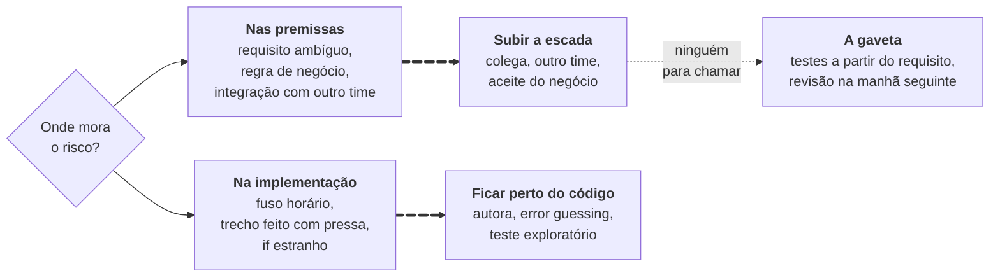

import { Referencia, Referencias } from "@site/src/components/Referencias";
import { Comparison, DataTable, Quote, Timeline } from "@gabrioliv/dossier";

# Independência de Teste

_O afastamento da obra como técnica de teste_

{frontMatter.description}

---

Stephen King tem um hábito curioso, contado em [_On Writing_](https://en.wikipedia.org/wiki/On_Writing:_A_Memoir_of_the_Craft). Quando termina o primeiro rascunho de um livro, ele guarda o manuscrito numa gaveta e passa pelo menos seis semanas sem abrir. Quando finalmente volta, lê o texto quase como se fosse de outra pessoa, e só então encontra os buracos que não via enquanto escrevia.

Nessas seis semanas o manuscrito continuou igual, e quem mudou foi o leitor. Logo depois de escrever, King lê o que quis dizer. Semanas depois, lê o que está na página.

Se você escreve código, já passou por isso, talvez sem perceber. Você termina uma funcionalidade, escreve os testes, roda a suíte, tudo verde. Dois dias depois alguém do time abre a tela, faz uma coisa que você nunca faria e o sistema quebra na primeira tentativa. A diferença entre vocês dois é que ela chegou sem as ideias que você tinha na cabeça enquanto programava.

Imagine uma desenvolvedora que acabou de escrever a regra de agendamento de uma clínica. Na cabeça dela, toda consulta dura 30 minutos. Ela escreve um teste que marca uma consulta às 9h e confere que o horário das 9h30 continua livre. Passa. Escreve outro para o fim do expediente. Passa também. O requisito, porém, dizia que consultas de retorno duram 15 minutos, e essa regra nunca entrou em teste nenhum, porque nunca entrou na cabeça de quem escreveu o código.

A psicologia chama isso de viés de confirmação. O psicólogo Raymond Nickerson, numa [revisão de décadas de pesquisa](https://doi.org/10.1037/1089-2680.2.2.175), descreveu esse viés como a tendência de buscar e interpretar evidências de um jeito que favorece aquilo em que já acreditamos. Quase sempre isso acontece sem intenção: a gente procura, sem perceber, justamente os casos em que a própria crença vai se confirmar. Quem testa o próprio código está testando a própria hipótese, e o defeito que mora fora dela fica invisível.

A saída que a área de teste encontrou é a mesma gaveta de King, só que trocando o tempo por outra pessoa. Chama-se independência de teste: a distância entre quem produziu algo e quem vai testar. Quanto mais longe do autor estiver o testador, menos ele compartilha as premissas que guiaram a escrita, e maior a chance de ele testar o caso que o autor nem imaginou.

A ideia é velha. Em 1979, Glenford Myers já escrevia em _The Art of Software Testing_ que um programador deve evitar testar o próprio programa. Para Myers, testar é executar um programa com a intenção de encontrar erros, e quem construiu o programa tem dificuldade de olhar para o próprio trabalho com essa vontade de destruir.

<Quote source="Glenford Myers, The Art of Software Testing (1979)">
  Testar é executar um programa com a intenção de encontrar erros.
</Quote>

O _syllabus_ da CTFL, a certificação básica de testadores mantida pelo [ISTQB](https://www.istqb.org/certifications/certified-tester-foundation-level-ctfl-v4-0/), transformou essa distância numa escada de quatro degraus. No primeiro, o próprio autor testa o que escreveu, e não há independência nenhuma. No segundo, quem testa é um colega do mesmo time, o que dá alguma independência. No terceiro, o teste vai para pessoas de fora do time, dentro da mesma empresa, e a independência é alta. No último, quem testa é alguém de fora da organização, e a independência é muito alta.

<DataTable
  caption="Os quatro degraus de independência (CTFL v4.0)"
  columns={[
    { key: "d", label: "Degrau" },
    { key: "q", label: "Quem testa" },
    { key: "i", label: "Independência" },
  ]}
  rows={[
    { d: "01", q: "O próprio autor", i: "Nenhuma" },
    { d: "02", q: "Um colega do mesmo time", i: "Alguma" },
    { d: "03", q: "Pessoas de outro time, na mesma empresa", i: "Alta" },
    { d: "04", q: "Alguém de fora da organização", i: "Muito alta" },
  ]}
/>

Cada degrau traz gente com outra formação, outra perspectiva técnica e outros vieses, e por isso cada degrau tende a encontrar tipos diferentes de defeito. Um testador de fora também consegue questionar premissas que todo mundo no projeto assumiu sem discutir. O syllabus também lista o outro lado. Quem testa de longe pode ficar isolado, se comunicar mal com quem desenvolve e acabar visto como gargalo, e os desenvolvedores podem relaxar com a qualidade porque "alguém vai testar depois". A recomendação dele é misturar os degraus, com desenvolvedores testando componentes, um time de teste olhando o sistema inteiro e o pessoal do negócio fazendo o teste de aceite.

<Comparison
  level={2}
  columns={[
    {
      code: "+",
      title: "O que a distância traz",
      lead: "Segundo a CTFL:",
      items: [
        "Outra formação, outra perspectiva técnica e outros vieses",
        "Tipos de defeito diferentes dos que o autor encontra",
        "Premissas da especificação e da implementação questionadas",
      ],
      active: true,
    },
    {
      code: "−",
      title: "O que a distância cobra",
      lead: "Também segundo a CTFL:",
      items: [
        "Isolamento do time de desenvolvimento",
        "Falhas de comunicação e relação de adversários",
        "Testador visto como gargalo e culpado pelo atraso",
        "Desenvolvedores menos responsáveis pela qualidade",
      ],
    },
  ]}
/>

A escada tem ainda um custo que costuma passar despercebido: quem está longe do autor também está longe do software. A mesma distância que tira do testador as premissas erradas tira junto todo o conhecimento que o autor acumulou.

Pense num controle deslizante. Numa ponta está a desenvolvedora da clínica, que sabe onde cada regra mora, quais partes ela fez com pressa e por que aquele `if` estranho existe, e que carrega todas as premissas que podem estar erradas. Na outra ponta está uma consultoria contratada, sem nenhuma dessas premissas e também sem nenhum desse conhecimento.

Agora acompanhe o tempo que cada um leva para começar a testar. A desenvolvedora começa no minuto em que termina o código. Um colega do time precisa de meia hora de conversa para entender a regra. Uma testadora de outro time precisa ler o requisito, entender como o convênio muda a duração da consulta e montar dados com médicos, salas e pacientes. A consultoria pode passar dias só aprendendo o vocabulário: o que é retorno, o que é encaixe, por que a agenda de sábado tem outra regra. Os números mudam de projeto para projeto, mas a ordem costuma ser essa. Quanto mais independente o testador, mais tempo ele gasta entendendo o software antes de saber como testá-lo. E um testador que ainda não entendeu o sistema costuma testar os casos óbvios, que a autora já tinha coberto, e aí a distância não rendeu nada.

<Figure title="CONTROLE DESLIZANTE DA INDEPENDÊNCIA">
  
</Figure>

Esse mesmo raciocínio explica por que revisões são feitas por outra pessoa. Quando você abre um _pull request_ e pede para um colega revisar, está subindo um degrau da escada antes mesmo de rodar o código. O colega tem contexto suficiente para entender a mudança e premissas diferentes o bastante para estranhar alguma coisa. Nas inspeções formais a distância cresce. Michael Fagan, que [descreveu o método de inspeção de código](https://doi.org/10.1147/sj.153.0182) usado na IBM nos anos 1970, recomendava que o moderador viesse de um projeto sem relação com o código revisado, para manter a objetividade. A CTFL atual conserva uma regra parecida: numa inspeção, o autor não pode liderar a revisão nem ser o escriba.

<Timeline
  events={[
    { at: "1976", label: "Fagan", note: "moderador de fora do projeto" },
    { at: "1979", label: "Myers", note: "o programador não testa o próprio programa" },
    { at: "1998", label: "Nickerson", note: "o viés de confirmação revisado" },
    { at: "2023", label: "CTFL v4.0", note: "a escada de quatro degraus", active: true },
  ]}
/>

O mesmo trecho da CTFL que apresenta a escada faz uma ressalva: independência não substitui familiaridade, e desenvolvedores encontram com eficiência muitos defeitos no próprio código.

As técnicas que a CTFL chama de baseadas em experiência mostram por quê. A mais conhecida é a suposição de erro, o _error guessing_, em que o testador prevê onde os defeitos vão aparecer a partir do que sabe sobre como o sistema se comportou no passado, sobre os erros que desenvolvedores costumam cometer e sobre as falhas de aplicações parecidas. A desenvolvedora da clínica sabe que tratou o fuso horário às pressas, então ela testa uma consulta marcada à meia-noite. A consultoria recém-chegada não tem como saber disso. O teste exploratório funciona do mesmo jeito: rende mais nas mãos de quem conhece o domínio e já viu o sistema falhar antes. E o teste baseado em _checklist_ usa listas montadas justamente a partir dessa experiência acumulada.

Na prática, cada risco pede uma distância. Quando o perigo está nas premissas, como um requisito ambíguo, uma regra de negócio que pode ter sido lida errado ou uma integração com o sistema de outro time, vale subir a escada. Quando o perigo está nos detalhes da implementação, quem conhece o código sabe onde procurar, e trazer alguém de longe só acrescenta dias de aprendizado.

<Figure title="QUE DISTÂNCIA CADA RISCO PEDE" full>

</Figure>

Num time saudável, os degraus convivem. A autora testa os componentes com o conhecimento que só ela tem. Um colega revisa o código e pergunta o que ela deixou de perguntar. Uma testadora de outro time confere o comportamento contra o requisito, sem saber como o código foi escrito. E quem pediu o sistema verifica, no aceite, se ele resolve o problema que motivou o projeto.

E quando não há ninguém para chamar, sobra a gaveta. Escrever os testes a partir do requisito antes de abrir o código, ou deixar a revisão do próprio _pull request_ para a manhã seguinte, cria um pouco da distância que King consegue em seis semanas de gaveta.

---

## Mapa Mental

- **🗄️ A gaveta de Stephen King**
  - O manuscrito não muda, quem muda é o leitor
  - Logo depois de escrever, o autor lê o que quis dizer, não o que está na página
- **🧠 Viés de Confirmação**
  - Buscar e interpretar evidências a favor do que já se acredita
  - Quem testa o próprio código testa a própria hipótese
  - O defeito fora da hipótese fica invisível
- **🪜 Escada de Independência (CTFL)**
  - 01 O próprio autor: nenhuma independência
  - 02 Colega do mesmo time: alguma
  - 03 Outro time da mesma empresa: alta
  - 04 Fora da organização: muito alta
- **⚖️ O Preço da Distância**
  - ➕ Outros vieses, outros defeitos, premissas questionadas
  - ➖ Isolamento, comunicação ruim, gargalo, desenvolvedor relaxa
  - Quem está longe do autor também está longe do software
  - Quanto mais independente, mais tempo para entender o sistema
- **🔍 Revisão como Degrau**
  - Pull request: colega com contexto e premissas diferentes
  - Inspeção de Fagan: moderador de outro projeto
  - CTFL: o autor não lidera a inspeção nem é o escriba
- **🛠️ Familiaridade Também Testa**
  - Error guessing: prever defeitos pelo que se sabe do sistema
  - Teste exploratório rende mais com quem conhece o domínio
  - Checklist montado a partir da experiência acumulada
- **🎯 Cada Risco Pede uma Distância**
  - Risco nas premissas: subir a escada
  - Risco na implementação: ficar perto do código
  - Sem ninguém para chamar: testes do requisito e revisão no dia seguinte

---

## Referências

<Referencias>

<Referencia tipo="Artigo" tema="Viés de Confirmação">

Nickerson, R. S. (1998). Confirmation Bias: A Ubiquitous Phenomenon in Many Guises. _Review of General Psychology_, 2(2), 175-220.

[https://doi.org/10.1037/1089-2680.2.2.175](https://doi.org/10.1037/1089-2680.2.2.175)

</Referencia>

<Referencia tipo="Artigo" tema="Inspeção de Código">

Fagan, M. E. (1976). Design and code inspections to reduce errors in program development. _IBM Systems Journal_, 15(3), 182-211.

[https://doi.org/10.1147/sj.153.0182](https://doi.org/10.1147/sj.153.0182)

</Referencia>

<Referencia tipo="Livro" tema="Teste de Software">

Myers, G. J. (1979). _The Art of Software Testing_. New York: John Wiley & Sons.

</Referencia>

<Referencia tipo="Referência" tema="Independência de Teste">

**ISTQB.** Certified Tester Foundation Level (CTFL) Syllabus v4.0. International Software Testing Qualifications Board, 2023.

[https://www.istqb.org/certifications/certified-tester-foundation-level-ctfl-v4-0/](https://www.istqb.org/certifications/certified-tester-foundation-level-ctfl-v4-0/)

</Referencia>

<Referencia tipo="Livro" tema="Afastamento da Obra">

King, S. (2000). _On Writing: A Memoir of the Craft_. New York: Scribner.

</Referencia>

</Referencias>

---
