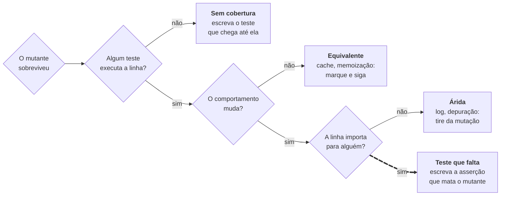

import { Referencia, Referencias } from "@site/src/components/Referencias";
import { Comparison, DataTable, Quote, Timeline } from "@gabrioliv/dossier";

# Testes de Mutação

_Quem testa os testers?_

{frontMatter.description}

---

Num aeroporto dos Estados Unidos, um agente de segurança olha a tela do raio-X e vê, dentro de uma mala de mão, a silhueta de uma arma. A arma não existe. O próprio equipamento desenhou aquela imagem sobre o raio-X de uma bagagem de verdade, para ver se o agente percebe. A TSA, agência que cuida da segurança dos aeroportos americanos, chama esse sistema de _Threat Image Projection_. Num relatório de 2016, o GAO, órgão de auditoria do Congresso americano, descreve o mecanismo como a projeção de ameaças fictícias, como armas e explosivos, sobre imagens de bagagens reais, com os resultados de cada aeroporto enviados a uma base nacional[^1].

A agência podia esperar uma arma de verdade passar pela esteira para descobrir se os agentes estão atentos. Preferiu plantar armas falsas e contar quantas eles encontram.

Se você escreve testes, a sua suíte é esse agente. Você confia nela porque ela fica verde, mas uma suíte sem nenhuma asserção também fica verde. A métrica de costume, a cobertura de código, só diz que cada linha rodou durante os testes. Ela não diz se algum teste conferiu o que a linha fez. A nota sobre [cobertura de testes](./test_coverage_sdlc) já mostrou o teste que executa a função e não verifica o resultado, mas sem uma forma de medir isso.

Pense na Camila, desenvolvedora de uma loja virtual. A regra que ela recebeu é simples: pedidos a partir de 200 reais têm frete grátis. Ela escreve a função e dois testes. Um pedido de 250 reais sai com frete zero. Um de 100 reais paga os 15 reais do frete. A ferramenta de cobertura marca cem por cento de linhas e de ramos, e o _pull request_ é aprovado na mesma tarde.

```js
function calcularFrete(totalDoPedido, frete) {
  if (totalDoPedido >= 200) return 0;
  return frete;
}
```

O teste de mutação faz com o código da Camila o que a TSA faz com as malas: planta um defeito de propósito e vê se alguém percebe. A ideia aparece em 1971, num trabalho de estudante de Richard Lipton[^2], e ganha forma no fim da década, com o artigo de Richard DeMillo, Lipton e Frederick Sayward publicado em 1978 na revista _IEEE Computer_[^3] e com um artigo de Richard Hamlet de 1977[^4]. Cada versão alterada do programa se chama mutante. A suíte inteira roda contra cada mutante, e se algum teste falha, a suíte percebeu a mudança.

<Quote source="Petrović e Ivanković, State of Mutation Testing at Google (2018), tradução livre">
  O teste de mutação avalia a eficácia de uma suíte de testes <span className="ds-hl">inserindo pequenas falhas nos programas</span> e medindo a capacidade da suíte de detectá-las.
</Quote>

DeMillo, Lipton e Sayward apoiaram o método em duas apostas. A primeira é a hipótese do programador competente: quem escreve o código chega perto do programa certo, e os defeitos que sobram são pequenos, como um sinal trocado ou um limite errado por um. A segunda é o efeito de acoplamento: testes capazes de separar o programa certo desses erros simples também tendem a pegar erros mais complexos[^3]. Se as duas apostas valem, basta plantar defeitos pequenos.

Os defeitos saem de regras fixas, os operadores de mutação, e cada operador sabe fazer um tipo de troca. O PIT, ferramenta de mutação para Java, liga onze deles por padrão[^5]. Um troca o operador relacional pelo vizinho de fronteira, e o `>=` vira `>`. Outro nega a condição, e o `>=` vira `<`. Outros trocam o valor devolvido por zero, por nulo, por verdadeiro ou por falso, ou apagam a chamada de um método que não devolve nada. Em 1996, Jeff Offutt e colegas mediram quais operadores valiam o custo e chegaram a um conjunto de cinco, que mexem em valor absoluto, operadores aritméticos, conectores lógicos, operadores relacionais e operadores unários[^6]. Cada operador gera um mutante em cada ponto do código onde se aplica, e cada mutante difere do original numa única mudança.

<DataTable
  caption="Três operadores padrão do PIT aplicados à função da Camila"
  columns={[
    { key: "o", label: "Operador" },
    { key: "t", label: "A troca" },
    { key: "c", label: "Na função da Camila" },
  ]}
  rows={[
    { o: "Negar condição", t: ">= vira <", c: "if (totalDoPedido < 200)" },
    { o: "Retorno primitivo", t: "o número devolvido vira 0", c: "return 0 no lugar de return frete" },
    { o: "Fronteira da condição", t: ">= vira >", c: "if (totalDoPedido > 200)" },
  ]}
/>

Com esses três operadores, a ferramenta cria três mutantes para a função da Camila. No primeiro, a condição vira `totalDoPedido < 200`, o pedido de 250 reais passa a pagar frete, o de 100 sai de graça, e os dois testes falham. No segundo, o `return frete` vira `return 0`, o pedido de 100 reais deixa de pagar frete, e o teste dele falha. No terceiro, o `>=` vira `>`. O pedido de 250 continua com frete grátis, o de 100 continua pagando, e os dois testes passam.

O PIT chama os dois desfechos de _killed_ e _survived_[^5]. Mutante morto é aquele que fez ao menos um teste falhar. Mutante sobrevivente passou por todos os testes sem que nenhum reclamasse. O morto confirma o que você esperava da suíte. O sobrevivente aponta, com linha e operador, um comportamento que nenhum teste fixa. O terceiro mutante da Camila diz exatamente o que falta: ninguém testou um pedido de 200 reais, o único valor em que `>=` e `>` discordam. Se alguém trocasse esse sinal numa refatoração, o cliente que fecha o carrinho em 200 reais pagaria frete, e a suíte continuaria verde. Quem conhece análise de valor limite reconhece o caso, e a ferramenta chegou até ele sem que ninguém pedisse.

<Figure title="TRÊS MUTANTES CONTRA DOIS TESTES">
  
</Figure>

Existem outros desfechos. O PIT chama de _no coverage_ o mutante numa linha que nenhum teste executa: ele sobrevive sem que teste algum tenha tido a chance de matá-lo. E um mutante que entra em laço infinito, como o que apaga o incremento de um contador, estoura o tempo limite[^5].

O _mutation score_, ou pontuação de mutação, é a fração de mutantes que a suíte detectou. O Stryker, ferramenta de mutação para JavaScript, divide os mutantes detectados pelos válidos e multiplica por cem. Detectados são os mortos mais os que estouraram o tempo, e válidos são os detectados mais os não detectados[^7], de modo que um mutante que nem compila fica fora da conta. A suíte da Camila matou dois de três mutantes: 67 por cento, com cobertura de cem. Ela escreve um terceiro teste, com um pedido de exatamente 200 reais e frete zero, e a pontuação sobe para cem.

A pontuação só serve como medida se os mutantes se parecerem com defeitos reais. Em 2014, René Just e colegas reuniram 357 defeitos reais, já corrigidos pelos desenvolvedores, de cinco aplicações de código aberto que somam 321 mil linhas, e mediram as duas coisas nas mesmas suítes. Encontraram correlação estatisticamente significativa entre detectar mutantes e detectar defeitos reais, independente da cobertura de código[^8]. Os autores também dizem que os resultados revelam limitações inerentes à análise de mutação.

Cada linguagem tem sua ferramenta. O PIT cobre Java[^5]. O Stryker tem versões para JavaScript e TypeScript, para C# e para Scala[^7]. Em Python, o mutmut[^9] faz o mesmo papel. O uso mais simples é local: rodar a ferramenta sobre o módulo que mais importa, como o cálculo de frete, os juros de um financiamento ou a regra de permissão de um usuário, e ler os sobreviventes um a um.

Rodar em tudo, toda noite, sai caro, e o custo é o problema mais antigo do método. Cada mutante pede uma execução da suíte, então um módulo com mil pontos de mutação pede mil execuções. Num artigo de 2018, Goran Petrović e Marko Ivanković contam como a Google contornou isso[^10]. O sistema deles gera mutantes só nas linhas alteradas de cada mudança de código, só nas linhas que algum teste cobre e no máximo um por linha. Os sobreviventes aparecem como comentários na revisão de código, em sete linguagens, entre elas C++, Java, Python e Go. Segundo o artigo, 6 mil engenheiros usavam o sistema em tudo o que escreviam ou revisavam, e a avaliação cobriu mais de 70 mil mudanças, 1,1 milhão de mutantes testados e 150 mil achados mostrados aos autores.

<Timeline
  events={[
    { at: "1971", label: "Lipton", note: "a ideia num trabalho de estudante" },
    { at: "1977", label: "Hamlet", note: "teste com ajuda do compilador" },
    { at: "1978", label: "DeMillo, Lipton e Sayward", note: "programador competente e acoplamento" },
    { at: "1996", label: "Offutt e colegas", note: "cinco operadores bastam" },
    { at: "2014", label: "Just e colegas", note: "mutantes e defeitos reais se correlacionam" },
    { at: "2018", label: "Google", note: "mutação dentro da revisão de código", active: true },
  ]}
/>

O artigo também conta o que deu errado no começo. Muitos sobreviventes não interessavam a ninguém, e o caso mais comum era a linha de log, que ninguém testa fora da própria biblioteca de log. O time passou a chamar essas linhas de áridas e a não gerar mutantes nelas, guiado pelo botão em que o desenvolvedor marca um achado como inútil. Com esse ciclo, a fração de achados considerados úteis subiu de 20 para 80 por cento[^10].

Daí vem a limitação mais incômoda, o falso sobrevivente. Um mutante equivalente muda o texto do programa sem mudar o que ele faz, e nenhum teste consegue matá-lo. O artigo da Google dá o exemplo da memoização, o cache que guarda o resultado de uma chamada cara: sem o cache, o programa fica mais lento e devolve as mesmas respostas. Os autores lembram que decidir se um mutante é equivalente é indecidível, então nenhuma ferramenta separa todos os casos sozinha[^10]. Semanas depois, a Camila guarda em cache a consulta de CEP que alimenta o frete. O mutante que remove o cache sobrevive, e ela gasta meia hora até concluir que não há teste a escrever. Na conta do Stryker, um mutante equivalente entra como não detectado e puxa a pontuação para baixo, e por isso cem por cento raramente é a meta certa.

<Comparison
  columns={[
    {
      code: "+",
      title: "O que a mutação entrega",
      lead: "Segundo as fontes citadas:",
      items: [
        "Mede se os testes conferem o comportamento, além de executar a linha",
        "Aponta o teste que falta, com linha e operador",
        "Detectar mutantes se correlaciona com detectar defeitos reais",
      ],
      active: true,
    },
    {
      code: "−",
      title: "O que a mutação cobra",
      lead: "Também segundo elas:",
      items: [
        "Uma execução da suíte para cada mutante",
        "Mutantes equivalentes que nenhum teste mata",
        "Sobreviventes sem interesse, como linhas de log",
        "Tempo de gente lendo sobrevivente por sobrevivente",
      ],
    },
  ]}
/>

Para quem decide se vale a pena, a conta fica assim: a mutação mostra o teste que falta com linha e operador, coisa que a cobertura não faz, e cobra tempo de máquina e horas de gente lendo resultados. A Google reduziu essa conta restringindo a mutação às linhas de cada mudança, e o mesmo recorte serve para um time de cinco pessoas.

<Figure title="O QUE FAZER COM UM SOBREVIVENTE" full>



</Figure>

A TSA não espera descobrir pelo jornal que um agente se distraiu: planta a arma falsa e conta quantas ele encontra. Você pode fazer o mesmo na próxima mudança que mexer numa regra de negócio. Rode a ferramenta da sua linguagem só sobre o arquivo alterado, leia cada sobrevivente e pergunte se ele descreve um defeito que poderia chegar ao cliente. Se descrever, escreva o teste que o mata. Se for um cache ou uma linha de log, marque e siga em frente. Anote quantos sobreviventes viraram teste: esse número diz mais sobre a suíte do que a pontuação.

---

## Mapa Mental

- **🧳 A arma falsa no raio-X**
  - A TSA projeta ameaças fictícias sobre bagagens reais
  - Plantar o defeito mede a atenção de quem procura
- **🧬 Origem e Conceito**
  - Lipton, 1971; Hamlet, 1977; DeMillo, Lipton e Sayward, 1978
  - Mutante: o programa com uma única mudança plantada
  - Hipótese do programador competente: os defeitos são pequenos
  - Efeito de acoplamento: quem pega o simples pega o complexo
- **🔧 Operadores de Mutação**
  - Fronteira: `>=` vira `>`
  - Negação: `>=` vira `<`
  - Retorno: o valor devolvido vira 0, nulo, verdadeiro ou falso
  - Offutt, 1996: cinco operadores bastam
- **💀 Mortos e Sobreviventes**
  - Morto: ao menos um teste falhou
  - Sobrevivente: todos os testes passaram
  - Sem cobertura: nenhum teste executa a linha
  - O sobrevivente da Camila: ninguém testou 200 reais
- **📊 Mutation Score**
  - Detectados divididos pelos válidos, vezes cem
  - Detectados: mortos mais os que estouraram o tempo
  - Camila: cobertura de 100%, pontuação de 67%
  - Just e colegas, 2014: correlação com defeitos reais
- **🛠️ Na Prática**
  - PIT para Java, Stryker para JavaScript, C# e Scala, mutmut para Python
  - Google: só linhas alteradas, um mutante por linha, na revisão de código
  - Achados úteis de 20% para 80% com o retorno dos desenvolvedores
- **⚖️ Limites**
  - Uma execução da suíte por mutante
  - Linhas áridas, como log
  - Mutante equivalente: falso sobrevivente, equivalência indecidível
  - Cem por cento raramente é a meta
- **🎯 A Prática**
  - Rodar só sobre o arquivo alterado
  - Ler cada sobrevivente e decidir: teste, equivalente ou árido

---

## Referências

<Referencias>

<Referencia tipo="Referência" tema="Teste de Vigilância">

U.S. Government Accountability Office (2016). Aviation Security: TSA Should Ensure Testing Data Are Complete and Fully Used to Improve Screener Training and Operations. GAO-16-704, setembro de 2016.

[https://www.gao.gov/products/gao-16-704](https://www.gao.gov/products/gao-16-704)

</Referencia>

<Referencia tipo="Artigo" tema="Teste de Mutação">

Jia, Y., & Harman, M. (2011). An Analysis and Survey of the Development of Mutation Testing. _IEEE Transactions on Software Engineering_, 37(5), 649-678.

[https://doi.org/10.1109/TSE.2010.62](https://doi.org/10.1109/TSE.2010.62)

</Referencia>

<Referencia tipo="Artigo" tema="Teste de Mutação">

DeMillo, R. A., Lipton, R. J., & Sayward, F. G. (1978). Hints on Test Data Selection: Help for the Practicing Programmer. _Computer_, 11(4), 34-41.

[https://doi.org/10.1109/C-M.1978.218136](https://doi.org/10.1109/C-M.1978.218136)

</Referencia>

<Referencia tipo="Artigo" tema="Teste de Mutação">

Hamlet, R. G. (1977). Testing Programs with the Aid of a Compiler. _IEEE Transactions on Software Engineering_, SE-3(4), 279-290.

[https://doi.org/10.1109/TSE.1977.231145](https://doi.org/10.1109/TSE.1977.231145)

</Referencia>

<Referencia tipo="Referência" tema="Ferramentas de Mutação">

PIT Mutation Testing. Basic Concepts e Mutation Operators. Documentação do PIT para Java.

[https://pitest.org/quickstart/basic_concepts/](https://pitest.org/quickstart/basic_concepts/)

[https://pitest.org/quickstart/mutators/](https://pitest.org/quickstart/mutators/)

</Referencia>

<Referencia tipo="Artigo" tema="Operadores de Mutação">

Offutt, A. J., Lee, A., Rothermel, G., Untch, R. H., & Zapf, C. (1996). An Experimental Determination of Sufficient Mutant Operators. _ACM Transactions on Software Engineering and Methodology_, 5(2), 99-118.

[https://doi.org/10.1145/227607.227610](https://doi.org/10.1145/227607.227610)

</Referencia>

<Referencia tipo="Referência" tema="Ferramentas de Mutação">

Stryker Mutator. Mutant states and metrics. Documentação do Stryker para JavaScript e TypeScript, C# e Scala.

[https://stryker-mutator.io/docs/mutation-testing-elements/mutant-states-and-metrics/](https://stryker-mutator.io/docs/mutation-testing-elements/mutant-states-and-metrics/)

[https://stryker-mutator.io/](https://stryker-mutator.io/)

</Referencia>

<Referencia tipo="Artigo" tema="Mutantes e Defeitos Reais">

Just, R., Jalali, D., Inozemtseva, L., Ernst, M. D., Holmes, R., & Fraser, G. (2014). Are Mutants a Valid Substitute for Real Faults in Software Testing? _Proceedings of the 22nd ACM SIGSOFT International Symposium on Foundations of Software Engineering (FSE 2014)_, 654-665.

[https://doi.org/10.1145/2635868.2635929](https://doi.org/10.1145/2635868.2635929)

</Referencia>

<Referencia tipo="Referência" tema="Ferramentas de Mutação">

mutmut. Mutation testing system for Python. Repositório do projeto.

[https://github.com/boxed/mutmut](https://github.com/boxed/mutmut)

</Referencia>

<Referencia tipo="Artigo" tema="Mutação na Indústria">

Petrović, G., & Ivanković, M. (2018). State of Mutation Testing at Google. _Proceedings of the 40th International Conference on Software Engineering: Software Engineering in Practice (ICSE-SEIP 2018)_.

[https://doi.org/10.1145/3183519.3183521](https://doi.org/10.1145/3183519.3183521)

</Referencia>

</Referencias>

[^1]: GAO (2016). _Aviation Security: TSA Should Ensure Testing Data Are Complete and Fully Used to Improve Screener Training and Operations_. GAO-16-704. [https://www.gao.gov/products/gao-16-704](https://www.gao.gov/products/gao-16-704)

[^2]: Jia, Y., & Harman, M. (2011). _An Analysis and Survey of the Development of Mutation Testing_. IEEE TSE. [https://doi.org/10.1109/TSE.2010.62](https://doi.org/10.1109/TSE.2010.62)

[^3]: DeMillo, R. A., Lipton, R. J., & Sayward, F. G. (1978). _Hints on Test Data Selection: Help for the Practicing Programmer_. IEEE Computer. [https://doi.org/10.1109/C-M.1978.218136](https://doi.org/10.1109/C-M.1978.218136)

[^4]: Hamlet, R. G. (1977). _Testing Programs with the Aid of a Compiler_. IEEE TSE. [https://doi.org/10.1109/TSE.1977.231145](https://doi.org/10.1109/TSE.1977.231145)

[^5]: PIT Mutation Testing. _Basic Concepts_ e _Mutation Operators_. [https://pitest.org/quickstart/basic_concepts/](https://pitest.org/quickstart/basic_concepts/)

[^6]: Offutt, A. J. et al. (1996). _An Experimental Determination of Sufficient Mutant Operators_. ACM TOSEM. [https://doi.org/10.1145/227607.227610](https://doi.org/10.1145/227607.227610)

[^7]: Stryker Mutator. _Mutant states and metrics_. [https://stryker-mutator.io/docs/mutation-testing-elements/mutant-states-and-metrics/](https://stryker-mutator.io/docs/mutation-testing-elements/mutant-states-and-metrics/)

[^8]: Just, R. et al. (2014). _Are Mutants a Valid Substitute for Real Faults in Software Testing?_ FSE 2014. [https://doi.org/10.1145/2635868.2635929](https://doi.org/10.1145/2635868.2635929)

[^9]: mutmut. _Mutation testing system for Python_. [https://github.com/boxed/mutmut](https://github.com/boxed/mutmut)

[^10]: Petrović, G., & Ivanković, M. (2018). _State of Mutation Testing at Google_. ICSE-SEIP 2018. [https://doi.org/10.1145/3183519.3183521](https://doi.org/10.1145/3183519.3183521)

---
