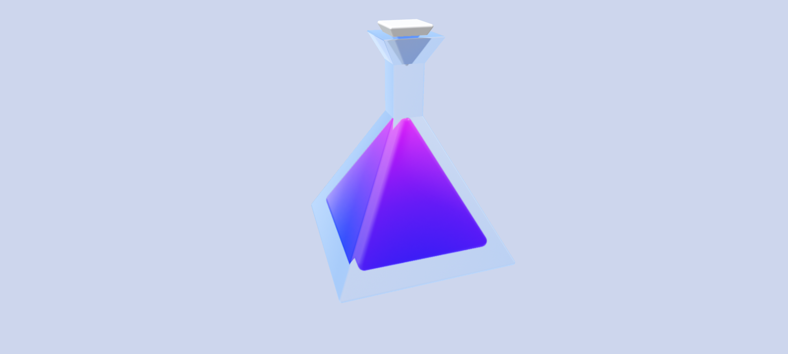
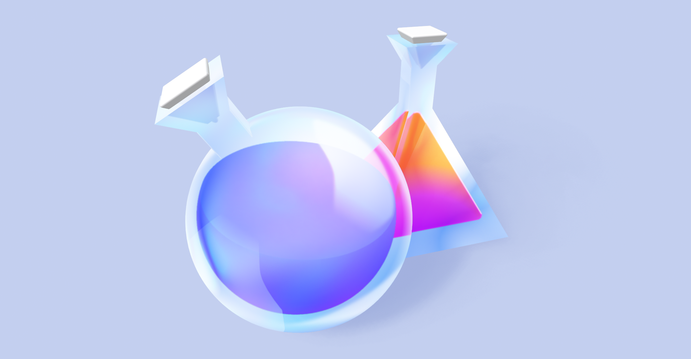

import Link from '@docusaurus/Link';
import {Grid, Stack} from '@gabrioliv/dossier';

import StageLegend from '@site/src/components/StageLegend';

import styles from '@site/src/css/styles.module.css';

<!--<h1 style={{textAlign: 'center'}}> Garden </h1>-->

	

		
	

	

		

			

				
			

			

				
			

			

				
			

		

	

---

## Certificações

Resumos de estudo usados para certificações.

<Grid minColumnWidth={280} gap={6}>
	<Stack gap={3} data-item="CTFL">

		

		<h3 className="ds-t-heading">CTFL - Certified Tester Foundation Level</h3>

		
Primeira certificação da ISTQB para a carreira de Teste de Software.

		<Link className="ds-link" to="/docs/istqb/ctfl">Leia Mais</Link>
	</Stack>
	<Stack gap={3} data-item="CT-TAS">

		

		<h3 className="ds-t-heading">CT-TAS - Test Automation Strategy</h3>

		
Certificação de Especialização para perspectiva estratégica sobre a automação de testes.

		<Link className="ds-link" to="/docs/istqb/cttas">Leia Mais</Link>
	</Stack>
</Grid>

---

## Documentações

Documentações variadas sobre Teste de Software, QA e Computação em geral.

<Grid minColumnWidth={280} gap={6}>
	<Stack gap={3} data-item="Notas">

		

		<h3 className="ds-t-heading">Notas</h3>

		
Notas sobre QA, Teste ou Computação em geral.

		<Link className="ds-link" to="/docs/notes">Leia Mais</Link>
	</Stack>
</Grid>

---

## Organização por Evolução

Documentação organizada por evolução de aprendizado e revisão.

<StageLegend />
