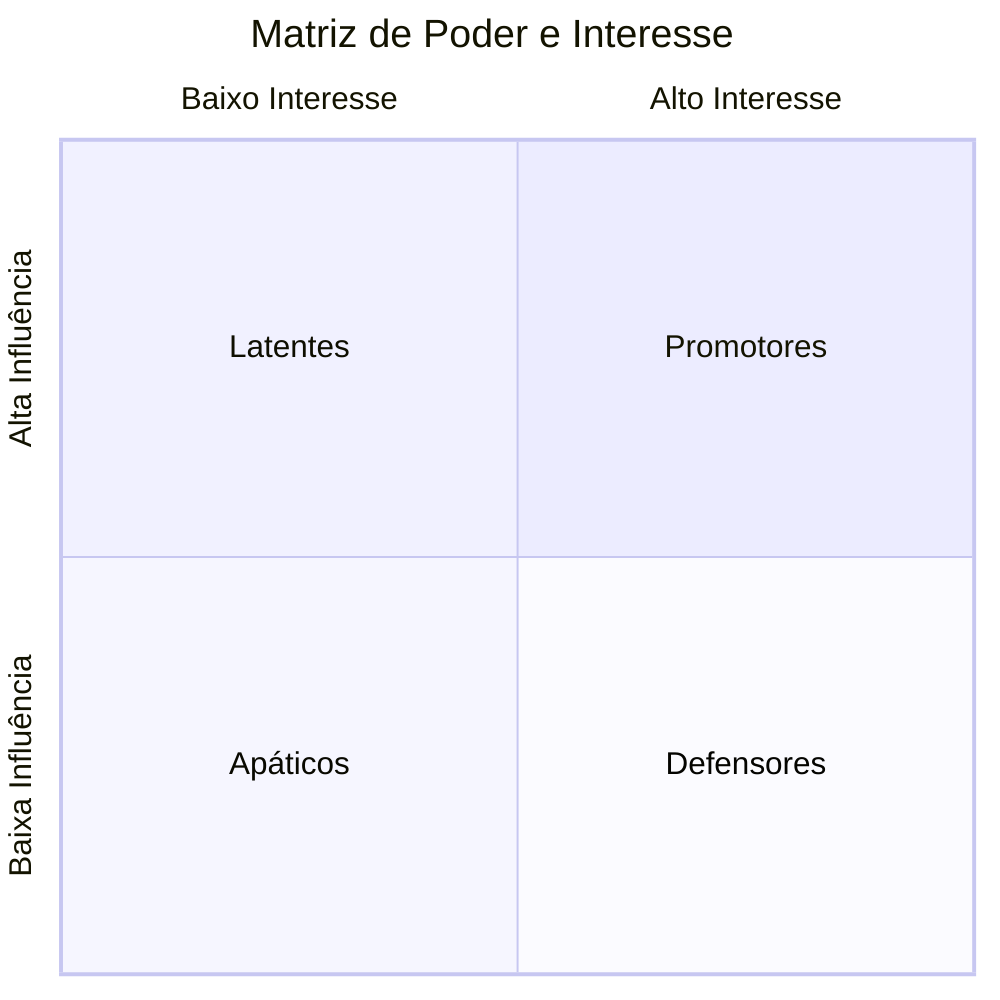
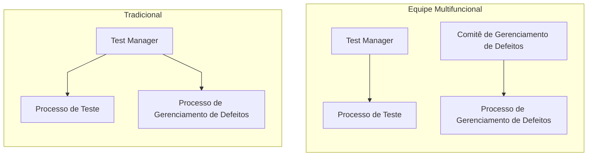
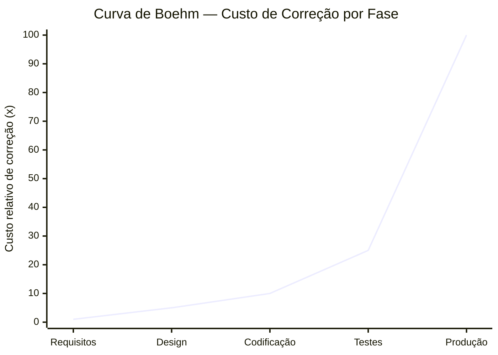

# 1 Gerenciando as Atividades de Teste

---

## 1.1 O Processo de Teste

Test Manager foca nessas atividades do Processo de Teste:

| Foco|Atividades|
| :---:| :--- |
| x |planejamento de teste|
| x |monitoramento e controle de testes|
| |análise de teste|
| |modelagem de teste|
| |implementação de teste|
| |execução de teste|
| x |conclusão de teste|

Atividade: Planejamento

- Definição de objetivos
- Abordagem
- Escopo
- Recursos
- Cronograma
- Resultados
- Participantes

Atividade: Monitoramento e Controle

- Monitoramento do
	- progresso
	- resultados
	- desvios
- Tomada de ações corretivas
- Comunicação do
	- status
	- resultados

Atividade: Conclusão

- Finalizar e arquivar os artefatos (testware)
- Avaliar
	- processo de teste
	- produto do teste
- Identificar melhorias no processo
- Comunicar o encerramento

>[!info] BASEADO NA NORMA ISO/IEC/IEEE 29119-2

---

### 1.1.1 Atividades de Planejamento de Teste

Planejamento é

- um processo iterativo
- pode abranger diferentes granularidades:
	- planejar testes do projeto
	- planejar testes da sprint
	- planejar testes de um tipo de teste

requer

- identificar
	- as atividades
	- recursos necessários
	- políticas de teste

Deve ser feita o mais cedo possível.
Começa e termina em diferente pontos do processo de dev.

Atividades básicas:

- Entender o contexto e organizar o planejamento do teste
	- Entender a empresa e as necessidades dos stakeholders em relação ao teste
- Identificar e analisar os riscos do produto
	- Identificar quais os riscos envolvendo o produto, probabilidade e impacto
- Identificar abordagens de tratamento de riscos
	- Analisar como tratar os riscos, ações:
		- preventivas
		- corretivas
		- atenuantes
- Definir a abordagem de teste, estimar e alocar recursos de teste
	- escolher a abordagem dependendo os dados levantados
	- escolher a equipe, ferramenta, ambiente
- Estabelecer o plano de teste
	- deve ser aceito pelos stakeholders sem divergência

---

### 1.1.2 Atividades de Monitoramento e Controle de Teste

ESSA É UMA ATIVIDADE CONTÍNUA

- Gerenciamento = Cronograma e Estrutura

O que ajuda:

- objetivos claros
- medidas
- metas

Controle:

1. comparar plano x real
2. realizar ações corretivas

- Implementar plano e diretrizes de controle
- Gerenciar desvios
- Tratar riscos recém identificados
- Estabelecer prontidão para inicial o teste
- Concluir o teste após o match com os critérios de saída

Monitoramento:

1. coletar
2. identificar

- Coleta de resultados de teste
- Registro de resultados de teste
- Identificação de desvios
- Identificação de riscos
- Análise de novos riscos
- Monitoramento de riscos alterados

---

### 1.1.3 Atividades de Conclusão do Teste

Acontece em MARCOS do projeto, por exemplo:

- versão
- fim de interação
- conclusão do nível

Quando HÁ ITENS NÃO RESOLVIDOS, criamos:

- solicitações de alteração
- itens de backlog

Quando os critérios de saída são atendidos:

- resultados são:
	- capturados
	- arquivados
	- fornecidos aos stakeholders

Atividades:

- Criar e aprovar relatório de conclusão
- Arquivar testware
- Transferência de material de teste
- Limpar e resetar ambiente de teste
- Executar/coletar/documentar lições aprendidas

---

## 1.2 O Contexto do Teste

Condições e restrições exclusivas que mudam como o teste deve ser feito.

Moldando decisões e estratégias.

Influenciam o contexto:

- Tipo de produto
- Setor de atuação
- Requisitos regulatórios
- forma do SDLC

Gerente de Teste deve 

- Escolher, não Desenvolver
- Entender o contexto
- Adequar o plano
- Escolher estratégias
- Escolher técnicas

---

### 1.2.1 Stakeholders no teste

Stakeholders no Teste:
Interesse DIRETO OU INDIRETO na qualidade.

POSSÍVEIS STAKEHOLDERS:

Desenvolvedores:

- implementar o SUT
- agir com base nos resultados
- envolvidos nos testes unitários
- contribuem no processo de teste

Testadores:

- preparam o material de teste
- ajudam no plano de teste com:
	- análise de requisitos
	- modelagem de teste
	- execução de teste
	- rastreamento de defeitos
	- relatório de defeitos
	- automação de teste
	- relatório de progresso

GP e PO:

- Especificam requisitos
- Definem qual o nível de qualidade requisitado
- Recomendam a cobertura necessária com base em riscos
- Analisam o produto
- Participam de UAT
- Tomam decisões com base em resultados de teste

Clientes e Usuários:

- Compram o produto
- Utilizam o produto
- Fonte de requisitos
- Envolvidos no UAT

> Podem haver mais tipos de stakeholders, depende do projeto. Ex: suporte, head, techlead, etc.

---

### 1.2.2 Importância do conhecimento dos stakeholders no gerenciamento de testes

Matriz de Poder e Interesse:

Categoriza os stakeholders para melhorar a interação.
ajuda em:

- priorizar envolvimento
- gerenciamento de expectativas
- escolher stakeholders para feedback do sistema
- valorizar diversas perspectivas
- depende do software analisado.
	- Um software de uso interno não terá os mesmos tipos de stakeholders que um software produto.

PROMOTORES:

- Liderança Comum: Gerenciar de perto
- Test Manager: Consultar

Colaboradores chave com alto interesse e poder.
Vitais para moldar a estratégia e plano de testes.

- Product Manager
- Product Owner
- Cliente Estratégico
- Patrocinador do Projeto

LATENTES:

- Liderança Comum: Manter satisfeitos
- Test Manager: Entregar relatórios mínimos

Não se importam com tarefas cotidianas.
Importantes para alocação de recursos e decisões de alto nível.

- Investidores
- Diretor financeiro (CFO)
- Diretor de outra área
- Head

DEFENSORES:

- Liderança Comum: Manter informados
- Test Manager: Receber Feedback Qualitativo

Fornecem feedback qualitativo sobre o produto.
Podem ser mantidos engajados com atualizações regulares.
Envolvimento em discussões específicas.

- Desenvolvedores
- QA/testers,
- Usuários finais
- Suporte

APÁTICOS:

- Liderança Comum: Monitorar
- Test Manager: Buscar percepção única

Não estão intimamente envolvidos.
Só atualização sobre marcos e buscar opiniões específicas.

- Fornecedor de infra não relacionado
- Devs de outras equipes
- Outros Product Owners

---

### 1.2.3 Gerenciamento de testes em um modelo de desenvolvimento de software híbrido

MODELO HÍBRIDO

- Abordagem Tradicional + Metodologia Ágil
- ex:
	- Modelo V ou Cascata com Scrum ou Kanban

Motivos:

- Híbrido como transição para Ágil
	- funciona como transição
	- facilita a mudança de cultura
- Híbrido como adequação à finalidade
	- moderniza tarefas que precisam
	- alteram somente atividades que fazem sentido

Atividades do Gerenciamento de Teste:

- Avaliar a compreensão da equipe sobre metodologias
- Identificar pontos fracos e fortes na adaptação
- Garantir que a equipe vai conseguir combinar processos
- Aprimorar colaboração entre equipe de teste e stakeholders na sprint
- Participar de esforços coordenados para manter a equipe focada. Como scrum-of-scrums para agilizar várias equipes.
- Revisar atividades de teste para garantir alinhamento com metodologia ágil

---

### 1.2.4 Atividades de gerenciamento de testes para vários modelos de ciclo de vida de desenvolvimento de software

Tabela de Atividades variando entre Sequencial e Iterativo.

| Atividade | Modelo Sequencial | Modelo Iterativo |
| :--- | :---: | :---: |
|Estimativa | detalhada para todas as etapas | de etapa em etapa, parte da iteração|
|Software de Teste | inclui estratégia, plano, casos, cronograma, relatórios | foca em critérios de aceite, doc mínimo|
|Funções | Test Manager supervisiona as decisões e gerencia de equipe | treinador substitui o Gerente de Teste tradicional|
|Ferramentas | ferramentas de gestão de testes em fases | ci, automações e testes contínuos|
|Abordagem de teste | programado com antecedência para as fases do projeto | incorporado às iterações|
|Automações de teste | estratégico, pode ocorrer em vários estágios | integrado desde o início, foco em regressão por ci/cd|
|Monitoramento e Relatórios | relatórios baseados em marcos | relatórios contínuos em tempo real|
|Métricas | tradicionais e gerenciamento de defeitos: taxa de execução, taxa de defeitos, etc | ágeis além das métricas tradicionais: burndown, velocidade de equipe|

---

### 1.2.5 Atividades de gerenciamento de testes em vários níveis de teste

Atividade necessárias por NÍVEL de teste.

|Nível de Teste | Gerenciamento|
|---|:---:|
|Teste de Componentes | Definir o escopo e objetivos, testadores em atividades de suporte e coordenar os devs na solução de problemas.
|Teste de Integração de Componentes | Determinar as sequencias de integração, supervisionar o progresso com os objetivos e cooperar com devs.
|Teste de Integração do Sistema | Garantir que o escopo esteja de acordo com os riscos e metas de qualidade. Manter supervisão de progresso e gerenciamento de problemas.
|Teste de Sistema | Adequar planejamento para o SDLC. Ágil: garantir teste contínuo. Sequencial: planejamento da fase de teste.
|Teste de Aceite | Confirmar os critérios de aceite, coordenar e gerenciar o UAT e ajudar na implantação fora do ambiente de dev.

---

### 1.2.6 Atividades de gerenciamento de testes para diferentes tipos de testes

Atividade necessárias por TIPO de teste.

|Tipo de Teste | Atividades|
|---|:---:|
|Testes Funcionais | planejamento, coordenação de progresso e alocação de recursos
|Testes Não Funcionais | benchmarking de performance e verificação de conformidade
|Testes Caixa Preta | análise de cobertura e incorporar feedback dos stakeholders
|Testes Caixa Branca | incorporar feedback técnico e validar a cobertura e uso de ferramenta

---

### 1.2.7 Atividades de gerenciamento de testes para planejar, monitorar e controlar

Atividade necessárias por FASE do processo de teste.

|Fase de Processo | Atividades|
|---|:---:|
|Planejamento de Teste | escopo, riscos, alocação
|Monitoramento de Teste | supervisão, otimização, colaboração
|Controle de Teste | decisão em desvios e adaptabilidade do processo

---

## 1.3 Teste Baseado em Risco

Os riscos podem ser levantados por qualquer stakeholder.

- identificar
- avaliar
- monitorar
- mitigar

> Risco Alto = Testar Cedo

---

### 1.3.1 Testes como uma atividade de mitigação de riscos

- Testes -> Acham Defeitos -> Ajuda a Mitigar
- Testes -> NÃO Acham Defeitos -> Baixo Risco

Test Manager deve fazer o Gerenciamento de Riscos de Qualidade

- Análise de Risco: identificação e avaliação de riscos
- Controle de Risco: monitoramento e mitigação de riscos

Importante:

- Registrar riscos ao gerenciar os testes
- Mitigar riscos de qualidade

Analisar riscos ajuda em várias etapas:

- Ajuda na acurácia do PLANEJAMENTO
- Ajuda a cobrir os casos na MODELAGEM
- Ajuda a priorizar os testes na EXECUÇÃO DOS TESTE

---

### 1.3.2 Identificação de riscos de qualidade

A tarefa do Test Manager é reunir os riscos dos stakeholders.

Técnicas de levantamento:

- Entrevistas com especialistas
- Avaliações independentes
- Retros (Evento do Scrum)
- Workshops de risco
- Brainstorming
- Listas de verificação
- Experiências passadas

Cuidados:

Variedade nos stakeholders
Acordar com o GP
Riscos não tem distribuição uniforme

> Subprodutos
> 1. Tem chance de descobrir riscos de outras áreas,
> 2. Subproduto não é o foco do Test Manager
> 3. Comunicar os riscos para as áreas
> 4. Ajudar outras parte do SDLC indiretamente

---

### 1.3.3 Avaliação do risco de qualidade

Processo de Avaliação:

1. Categorizar
2. Determinar Probabilidade
3. Determinar Impacto
4. Calcular Nível

PASSOS:

1 - Categorizar

- por TIPO
	- exemplo:
		- Risco de produto
		- Risco de projeto
- por ÁREA:
	- exemplo:
		- Interface
		- Performance
		- Segurança

2 - Determinar Probabilidade

- Pode ser Qualitativa: Baixo, Médio, Alto
- Pode ser Quantitativo: Se houve uma base de dados

3 - Determinar Impacto

- Pode ser Qualitativa: Baixo, Médio, Alto
- Pode ser Quantitativo: Se houve uma base de dados

4 - Calcular Nível

- Matriz de Risco: Se Qualitativo
- Cálculo: Se Quantitativo

> Matriz de Risco é mais comum.

---

### 1.3.4 Mitigação do risco de qualidade por meio de testes apropriados

Resumo: Focar em testar da melhor forma e logo os riscos maiores

Estratégias de Teste: Depth-First ou Breadth-First

| | DFS Depth-First | BFS Breadth-First |
|:---|:---:|:---:|
| Foco | Profundidade | Abrangência |
| Método | Maior risco primeiro | Todos os riscos pelo menos uma vez |
| Objetivo | Mitigar riscos graves | Demonstrar uma visão abrangente dos testes |
| Uso | Risk-based testing | Prazos curtos |

![[ctal_tm_bfs_dfs_animacao.svg]]

---

### 1.3.5 Técnicas para teste baseado em risco

A escolha da técnica depende do projeto, processo e produto.

As técnicas podem ser Leves ou Pesadas.

Técnicas PESADAS:

Estruturadas e completas para resolver o problema.

- Análise de Perigo: processo analítico para identificar perigos adjacentes.
- Custo de Exposição: determinar o risco de cada falha, depois o custo associado aos testes e a falha
- Failure Mode and Effect Analysis (FMEA):
	- identifica os riscos, causas e efeitos
	- atribui gravidade, prioridade, taxa de detecção
- Fault Tree Analysis
	- passos
		1. relaciona os defeitos para cada falha  
		2. relaciona os erros para cada defeitos
		3. continua a análise até identificar todas as causas-raiz
	- falha -> defeito -> erro -> causa-raiz = mitigar

Técnicas LEVES:

Simples e fáceis de implementar.
Geralmente baseado na entrada dos stakeholders com requisitos ou especificações do software.

- Systematic Software Testing (SST)
- Pragmatic Risk Analysis and Management (PRAM)
- Product Risk Management (PRISMA)

---

### 1.3.6 Métricas de sucesso e dificuldades associadas aos testes baseados em riscos

Sucesso se for possível responder com SIM para essas perguntas:

- Os stakeholders importantes participaram?
- O envolvimento dos stakeholders foi adequado?
- Incidentes de riscos críticos em prod foram resolvidos?
- Maioria dos altos riscos foram encontrados cedo?
- Possível explicar os test results em termos de risco?
- Testes ignorados tem risco baixo?

Problemas que podem acontecer:

| Problema | Solução |
| --- | --- |
| Dificuldade em metrificar riscos | Usar histórico de dados |
| Não existe um bom começo | Faça regularmente e com relatórios |
| Riscos duplicados e ignorados | Use pessoas certas e mitigue só o que importa |
| Principais riscos perdidos | Treine as pessoas certas para identificar riscos |
| Mudança de stakeholders e novos riscos | faça a análise com frequência |

---

## 1.4 A Estratégia de Teste do Projeto

Em um projeto:

- Planejamento de Testes -> Estratégia de Teste

"Estratégia de Teste" visa o objetivo do projeto.

---

### 1.4.1 Escolha de uma abordagem de teste

> Qualquer teste pode ser feito em qualquer fase;
> MAS ISSO NÃO É EFICIENTE.

Estratégia é escolher os aspectos dos testes com melhor fit.

Escolher diferentes abordagens e níveis que juntos entregam o melhor resultado.

---

### 1.4.2 Análise da estratégia de teste organizacional, do contexto do projeto e de outros aspectos

Características a analisar:

- Domínio: qual será o domínio do produto construído.
	- software de gestão geral é mais suave em regras
	- software de hospital precisa se maior rigor de validação
- Metas Organizacionais: o que a própria organização exige.
	- pode ser exigido maior nível de automação
	- ou maior entrega de relatórios
- Metas de Projeto: exigências próprias do projeto
	- pode exigir relação maior com tempo gasto ou custo
	- certas restrições orçamentárias
- Recursos de Teste: restrições de recursos e infraestrutura
	- custos de ferramentas, ambiente, máquinas
	- dispositivos mobiles que precisam ser testados
- SDLC do Projeto: tradicional ou ágil
	- o tipo de SDLC vai importar na hora de escolher os testes
- Interface com outros sistemas: sistema de sistemas
	- testes de integração podem ser necessários
	- alinhar os testes com outras equipes
- Disponibilidades de Dados de Teste: configuração de ambiente
	- testes com dados anonimizados, dados para testes com IA
	- criação de dados e população de banco

Dadas as características, o Test Manager monta a melhor estratégia.

---

### 1.4.3 Definição dos objetivos do teste

Metodologia de Metas: SMART

Uma meta devem ser:

| Term | Mnemonic | Significado |
| :--- |:--- | :--- |
| Specific | Specífica | Objetivo claro |
| Measurable | Mensurável | Medição de progresso |
| Achievable | Atingível | Viável considerando os recursos |
| Relevant | Relevante | Alinhado aos objetivos do projeto |
| Timely | Timeline | Prazo definido para conclusão |

Algumas metas de exemplo:

- Atingir os critérios de saída específicos
- Cumprir regras e regulamentos do setor
- Garantir disponibilidade dos dados aos usuários
- Automação de testes para testes de regressão

---

## 1.5 Aprimoramento do Processo de Teste

Testes custam entre 30% a 40% do projeto.

Esse processo precisa ser aprimorado.

---

### 1.5.1 O processo de aprimoramento de testes (IDEAL)

| |en| pt |
|:---:|:---|:---|
| I | Initiating | Iniciar |
| D | Diagnosing | Diagnosticar |
| E | Establishing | Estabelecer |
| A | Acting | Agir |
| L | Learning | Aprender |

Passar esse plano de melhoria em crivos de análise de risco e ROI.

---

### 1.5.2 Melhoria do processo de Teste Baseado em Modelos

Usa a premissa de que:

Qualidade do Produto -> vem de Qualidade de Processos

Existem vários modelos de melhoria de processos de teste:

- Test Maturity Model Integrated (TMMi)
	- Modelo registrado copyright
	- Usa 5 níveis de maturidade
	- Cada nível contém áreas de processo e metas de melhoria
- TPI NEXT
	- Modelo registrado copyright
	- define 16 áreas-chave
	- cada uma abrange um aspecto específico do processo de teste
	- cada uma com 4 níveis de maturidade

---

### 1.5.3 Abordagem de melhoria do processo de Teste com Base Analítica

Usa os próprios dados dos projetos e equipe para melhorar o processo de teste.

Usam dados qualitativos e quantitativos.

Exemplos de abordagens analíticas:

- Análise de Causa Raiz
	- Encontrar soluções de problemas
- Análise usando medida, métricas e indicador
	- Forma de avaliar performance
- Abordagem GQM (Goal-Question-Metric)
	- Estrutura para definir e analisar métricas

---

### 1.5.4 Retrospectivas

Reuniões em que as equipes avaliam métodos e colaboração.

Em SDLC Sequencial e Ágil

Etapas básicas:

- Introdução -> objetivo e agenda
- Coleta de Dados -> dados sobre o que aconteceu na iteração
- Derivar Melhorias -> análise de dados para causa-raiz
- Decidir ações de melhorias -> ações para solução
- Retrospectiva de fechamento -> fechamento e documentação

---

## 1.6 Ferramentas de Teste

3 TIPOS:

- Comerciais
- Open-Source
- Personalizadas

---

### 1.6.1 Boas práticas para a introdução de ferramentas

Test Manager pode estar envolvido na introdução de ferramentas.

Boas práticas para AVALIAÇÃO:

- Identificar oportunidades
- Compreender as tecnologias usadas
- Entender como uma ferramenta é integrada ao SDLC
- Avaliar os requisitos claros da ferramenta
- Avaliar o fornecedor/suporte da ferramenta
	- fornecedor se comercial
	- suporte se open-source
- Identificar requisitos internos para treinamento
- Prós e Cons do licenciamento
- Prova de Conceito (MVP)

Boas práticas para IMPLEMENTAÇÃO:

- Execute um projeto piloto
- Adaptar e avaliar processos
- Definir diretrizes de uso
- Fornecer treinamento
- Implementar a ferramenta ao poucos
- Coletar dados de uso real para melhorias
- Definir propriedade da ferramenta

---

### 1.6.2 Aspectos técnicos e comerciais das decisões sobre ferramentas

Normas e segurança: empresa possui alguma missão crítica ou regra de conformidade.

Aspectos financeiros: limitações de orçamento ou custo de pessoal para manutenção.

Requisitos dos stakeholders: esses requisitos são atendidos pela ferramenta.

Cenário de software: já existe alguma ferramenta ou ecossistema que limita ou sobrepõe uma nova.

---

### 1.6.3 Considerações sobre o processo de seleção e avaliação do retorno sobre o investimento

É necessário assegurar um ROI em vários pontos de vista

Qual é o esperado para cada cargo da organização:

| Cargo | Foco da Ferramenta |
| --- | --- |
| Gestão | ROI positivo para a gestão |
| Suporte | Poucas ferramentas para dar manutenção e configurar |
| GP | Agregar valor mensurável |
| Usuário | Usabilidade e operacionalidade |
| Operacional | Facilidade de manutenção |

Realizar análise de Custo-Benefício:

Custos não recorrentes:

- Definir e determinar requisitos
- Avaliação e seleção da ferramenta
- Adquirir e adaptar ferramenta inicialmente
- Definir diretrizes
- Treinamento inicial
- Integrar a ferramenta
- Aquisição do hardware/software

Custos recorrentes:

- Licenciamento
- Manutenção
- Treinamento
- Portabilidade/Infraestrutura

Riscos de ROI:

- Imaturidade da organização
- Mudanças nas politicas de manutenção
- Custos mais altos
- Benefício menor

Benefícios de Ferramentas de Teste

- Redução do trabalho manual
- Aceleração do ciclo de teste
- Redução dos custos de execução
- Aumento de cobertura
- Redução de erros humanos
- Acesso a dados dos testes (Relatórios)

---

### 1.6.4 Ciclo de vida da ferramenta

Há 4 estágios no Ciclo de Vida de uma ferramenta.

1. Aquisição
2. Manutenção
3. Evolução
4. Aposentadoria

---

### 1.6.5 Métricas de ferramentas

Exemplos de dados coletados de ferramentas.

- Gerenciamento de Teste
	- itens de teste
	- testes executados
	- status dos testes
	- testes aprovados
- Gerenciamento de Requisitos
	- cobertura de requisitos
	- casos de teste aprovados
- Gerenciamento de Defeitos
	- info dos defeitos
	- porcentagem de detecção
	- níveis de teste executados
- Análise Estática
	- complexidade do código
- Teste de Performance
	- tempo de resposta
	- taxa de falha
- Cobertura de Código
	- Objetos de teste cobertos
- Ferramentas de Teste
	- número de defeitos encontrados
	- cobertura dos requisitos

---

# 2 Gerenciando o Produto

---

## 2.1 Métricas de Teste

> Por que ter métricas de teste?
> 
> "O que é medido, é feito"

TIPOS DE MÉTRICAS:

- Métricas do projeto
- Métricas do produto
- Métricas do processo

> Projeto: medir critérios de saída do projeto
> Produto: Atributos do produto e qualidade
> Processo: Capacidade e eficiência do processo

---

### 2.1.1 Métricas para atividades de gerenciamento de testes

1. Definir métricas no planejamento
2. Coletar no monitoramento
3. Registrar na conclusão

Exemplos de métricas:

| Métrica | Monitoramento | Conclusão |
| --- | :---: | :---: |
| Cobertura de requisitos | X | X |
| Cobertura dos riscos do produto | X | X |
| Cobertura de código | X |  |
| Estimativa de teste real vs. planejada | X | X |
| Porcentagem de casos de teste executados | X | X |
| Número acumulado de defeitos encontrados vs. resolvidos | X |  |
| Casos de teste automatizados |  | X |

> Uma métrica importante: 
> 
> Porcentagem de Detecção de Defeitos (DDP)

---

### 2.1.2 Monitoramento, Controle e Conclusão

Métricas são indicadores de que os testes evoluíram.

Controle usa os indicadores como base para as ações.

Conclusão usa os dados finais para criar as lições aprendidas.

---

### 2.1.3 Relatório de Teste

As métricas corretas são a base de um relatório útil.

Exemplos de tipos de métricas:

Risco
Defeitos
Progresso
Cobertura
Custos

---

## 2.2 Estimativas de Teste

---

### 2.2.1 Estimativa das atividades que o teste envolverá

Critérios de uma estimativa:

- Esforço
- Tempo
- Custo

Passos para uma estimativa:

1. Identificar o Nível de teste
2. Dividir os testes necessários em etapas
3. Estimar o esforço por etapas

---

### 2.2.2 Fatores que podem influenciar o esforço de teste

A estimativa envolve a previsão de quantidade de trabalho relacionado.
Os fatores que influenciam esse esforço de teste pode ser:

- Produto:
	- Qualidade da base
	- Tamanho do produto
	- Complexidade do domínio
	- Requisitos de qualidade dos testes (ex: alta confiabilidade)
- Processo de Desenvolvimento:
	- Estabilidade e Maturidade de processos
	- Modelo de desenvolvimento
	- Fatores materiais (ex: disponibilidades de ferramentas)
- Pessoas:
	- Satisfação das pessoas
	- Habilidades e experiencias de pessoas envolvidas
- Resultados do Teste:
	- Gravidade dos defeitos encontrados
	- Quantidade de retrabalho
- Contexto do Teste:
	- Complexidade do projeto
	- Tipo de trabalho (local ou remoto)

---

### 2.2.3 Seleção de técnicas de estimativa de teste

Estimar é difícil quando a qualidade geral do software é baixa.

A seleção da técnica de estimativa depende de:

- Erro de estimativa
- Disponibilidade de dados
- Disponibilidade de especialistas
- Conhecimento em modelagem
- Restrições de tempo

As estimativas são dependentes do Contexto do Teste.

Técnicas comuns

- Wideband Delphi para modelo sequencial
- Planning Poker para modelo ágil
- Estimativa de 3 Pontos (explica na CTFL)
- 

---

## 2.3 Gerenciamento de Defeitos

Atividades que começam após observar que resultados reais divergem de resultados esperados.

- OU Gerenciamento de Defeitos - Syllabus
- OU Gerenciamento de Incidentes -  ISO/IEC/IEEE 29119-3
- OU Gerenciamento de Anomalia - TMAP

Uma boa ferramenta de gerenciamento:

- Permite uma visão do projeto em todo o SDLC
- Coleta dados dos defeitos
- Ajuda na tomada de decisão

---

### 2.3.1 Ciclo de Vida do Defeito

- Descoberta do defeito
- Preenchimento de relatório
- Relatório evolui com o avanço dos testes
- Relatório no fim será usado para:
	- Análise do defeito
	- Correção do defeito
	- Teste de confirmação

Fluxo de trabalho:

![[diagrama-estados-azul.svg]]

As etapas e fluxo podem variar.

- **Aberto**: Estado inicial, quando o formulário é feito.
- **Em Andamento**: Equipe está trabalhando, análise ou correção.
- **Rejeitado**: Desconsiderado segundo algum critério.
- **Resolvido**: Corrigido ou pronto para o teste de confirmação.
- **Fechado**: estado terminal, não requer nenhum trabalho adicional.

Boas Práticas:

- O mesmo fluxo de trabalho deve estar vigente em toda a organização para facilitar o gerenciamento
- Defeitos duplicados e Falsos-positivos devem ser classificados por um estado separado. Sendo útil em análises futuras para melhorar o processo de teste
- Uso de apenas um único estado terminal
- Os nomes dos estados devem ser os mesmos de outras entidades, para facilitar o trabalho
- Estados consecutivos devem pertencer a funções responsáveis diferentes
- Cada estado precisa de mais de um estado de saída. Exceto o estado terminal. Para que haja a tomada de decisão
- Atributos inseridos na transição de estados devem possuir valor. Não criar artefatos desnecessários.

---

### 2.3.2 Gerenciamento de defeitos multifuncional

- Comum:
	- O Test Manager é o dono do
		- Processo de Teste
		- Processo de Gerenciamento de Defeitos
- Equipe Multifuncional:
	- O Test Manager
		- Processo de Teste
	- Comitê de Gerenciamento de Defeitos
		- Gerenciamento de Defeitos

Reunião de Triagem: usada pelo comitê para decidir se o defeito deve ou ser aceito/corrigido/rejeitado.

Em projetos muito grandes, pode um gerente de defeitos.

---

### 2.3.3 Especificidades do gerenciamento de defeitos em equipes ágeis

Em equipes ágeis, o gerenciamento de defeitos pode ser feito por comunicação

MAS O RELATÓRIO É NECESSÁRIO QUANDO:

- Defeito bloqueia uma atividade da sprint
- Defeito que não pode ser resolvido na mesma iteração
- Defeito que precisa de outras equipes para resolver
- Defeitos que devem ser resolvidos por um fornecedor
- Defeito que um relatório é explicitamente solicitado

O relatório deve refletir os aspectos da equipe.

Decisões sobre um defeito devem ser documentados.

---

### 2.3.4 Desafios do gerenciamento de defeitos no desenvolvimento de software híbrido

Desafios:

- Alinhamento de quais ferramentas devem ser usadas
	- cada equipe acaba usando uma ferramenta diferente
- Priorização de defeitos
	- dificuldade em realizar reuniões de gerenciamento de defeito
- Transparência do plano de teste
	- é necessário compartilhar os plano com o restante da equipe

---

### 2.3.5 Informações do relatório de defeitos

As informações em um relatório de defeitos devem ser suficientes para:

- Gerenciamento do relatório de defeitos durante o ciclo de vida do defeito
	- > conseguir gerenciar o defeito com o relatório
- Avaliação do status geral do projeto, qualidade de produto e progresso dos testes
	- > conseguir medir se o produto está muito quebrado
- Avaliação do status de um incremento em qualidade de produto
	- > saber quais defeitos são levantados de cada feature
- Avaliação da capacidade do processo
	- > saber se o processo está rodando como deveria

Itens que devem ser contidos em cada relatório de defeito:

- Título do Defeito + Resumo da anomalia
- Descrição detalhada da anomalia + Etapas de reprodução
- Gravidade do impacto
- Prioridade para corrigir anomalia

Dados importantes gerados pela ferramenta de gerenciamento:

- Identificador único
- Data/Hora do relatório
- Nome da pessoa/tester que descobriu
- Fase do projeto em que a anomalia foi encontrada
- Estado atual do relatório
- Atual Responsável
- Histórico de Mudanças
- Referências (casos relacionados, defeitos relacionados)

 ISO/IEC/IEEE 29119-3 complementa sobre mais dados coletáveis.

As informações podem ser agrupadas em:

- Para ajudar na resolução do defeito
	- > Ex.: Informações sobre o esperado x atual
- Para avaliar o status geral do projeto
	- > Ex.: riscos, custos de cada defeito
- Para avaliar a qualidade de um único incremento de produto
	- > Ex.: resumo e agrupamento de riscos e tipos de defeito
- Para avaliar a capacidade do processo
	- > Ex.: fase da SDLC de detecção e remoção do defeito

---

### 2.3.6 Definição de ações de melhoria do processo usando informações do relatório de defeitos

Iniciativas para melhorias de processo

| Informação | Iniciativa |
| --- | --- |
| Fases de introdução, detecção e remoção de defeitos | Maneiras de melhorar a eficácia da detecção de defeitos em cada fase |
| Fase de maior número de defeitos | Melhorias direcionadas à prevenção de defeitos |
| Causa-raiz dos defeitos | Melhorias para redução do número total de defeitos |
| Localização de defeitos e grupos de defeitos | Melhorar análise dos riscos técnicos e refatoração de componentes problemáticos |
| Defeitos reabertos | Qualidade das implementações de depuração |
| Defeitos duplicados e rejeitados | Qualidade da criação do relatório de defeitos |
| Número total de defeitos | Medidas proativas para evitar erros antecipadamente |

> NÃO RASTREAR DEFEITOS
> 
> Algumas gestões decidem não rastrear os defeitos no SDLC.
> 
> Motivo:
> 
> - Feito em nome da eficiência e redução do processo
> 
> Consequência:
> 
> - Reduz a visibilidade dos recursos do processo de desenvolvimento
> - Reduz a visibilidade dos recursos de teste de software
> - Dificulta a realização das melhorias baseadas em dados
> - Falta de dados de suporte confiáveis

---

# 3 Gerenciando a Equipe

---

## 3.1 A Equipe de Teste

---

### 3.1.1 Habilidades típicas em quatro áreas de competência

- Competência Profissional
	- Tarefas especializadas
	- Conhecimento de negócio de domínio
	- Conhecimento tecnológico
- Competência Metodológica
	- Habilidades Gerais
	- Habilidades analíticas
	- Habilidades conceituais
- Competência Social
	- Habilidade de Comunicação
	- Cooperação
	- Gerência de Conflitos
- Competência Pessoal
	- Desenvolver o próprio talento
	- Autogerenciamento
	- Responsabilidade
	- Receber críticas

Todas as áreas são importantes para um profissional.

O ISTQB se concentra validar a competência profissional.

---

### 3.1.2 Analisar as habilidades necessárias dos membros da equipe de teste

Competência Profissional & Metodológica

- Tarefas de Teste
	- Planejamento de Teste
	- Implementação de Teste
	- Execução de Teste
	- etc

Competência Social

- Interagir e Comunicar com a Equipe

Competência Pessoal

- Equipe autogeradas requerem um nível alto de Autogerenciamento
- Gerente de Teste precisa saber delegar tarefas

---

### 3.1.3 Avaliação das habilidades dos membros da equipe de teste

Equipes diversas são mais eficazes.

Deve se observar as atividades típicas de teste para saber as competências profissionais e metodológicas.

Também é possível validar competências por certificações e experiência profissional.

---

### 3.1.4 Desenvolvimento das habilidades dos membros da equipe de teste

É possível aprender as habilidades necessárias.

Métodos:

| Método | Exemplo |
| --- | --- |
| Treinamento e Educação | Fazer um curso |
| Autoestudo | ler livros, assistir videos |
| Pares | Dois colegas compartilham conhecimentos |
| Mentoring ou Coaching | Orientação Individual de um Senior |
| Treinamento | Ensino sobre uma prática direta no trabalho |

Nem todas as abordagens são igualmente eficazes.

---

### 3.1.5 Habilidades gerenciais necessárias para gerenciar uma equipe de teste

- Resiliência
- Capacidade de Delegar
- Capacidade de ser aceito

- Afirmar Interesses
- Promover Benefícios
- Resolver Conflitos

Modelo de Tuckman

Modelo geral para formação e liderança de equipes.

| Stage | Estágio | Exemplo |
| --- | --- | --- |
| Forming | Formação | Juntar pessoas à equipe |
| Storming | Confronto | Resolver conflitos da equipe |
| Norming | Normalização | Liderança por metas e valores |
| Performing | Desempenho | Delegar e atribuir responsabilidade |
| Adjourning | Encerramento | Agir com apreço aos membros que saem |

---

### 3.1.6 Fatores motivadores ou desmotivadores para uma equipe de teste em determinadas situações

Equipe motivada melhora a produtividade

- Teoria de Dois Fatores
	- Motivadores
	- Fatores de Higiene

Motivadores:

- Reconhecimento
- Autonomia
- Responsabilidade
- Tarefas interessantes, significativas
- Avanço e desenvolvimento

Fatores de Higiene:

- Remuneração adequada
- Politica de valorização
- Condições de trabalho
- Segurança (cumprimento de acordos)
- Bom relacionamento interpessoal

---

## 3.2 Relacionamentos com os stakeholders

É importante para o Test Manager criar valor comercial para os testes.

Test Manager deve ajudar o stakeholder a entender o equilíbrio entre testes e prazos

---

### 3.2.1 Custo da qualidade

Manter a qualidade gera um custo que deve ser claro

- Custos de Prevenção de Defeitos
- Custo de Avaliação
- Custos de Falhas Internas
- Custos de Falhas Externas

---

### 3.2.2 Relação custo-benefício dos testes

- Benefícios Qualitativos
	- Ex.: melhor reputação do software
- Benefícios Quantitativos
	- Ex.: quantidade de defeitos encontrados

Cálculos de Custos de Defeitos

Economia Média por Defeito (EMD)

$$EMD = \text{Média de } CFex - (\text{Média de } CAv + \text{Média de } CFin)$$

$$EMD = \text{Média de Falhas Externas} - (\text{Média de Avaliação} + \text{Média de Falhas Internas})$$

- Onde:
	- **CFex**: Custo de Falhas Externas
	- **CAv**: Custos de Avaliação
	- **CFin**: Custo de Falhas Internas

> Valor de falhar externamente, menos o custo de identificar um defeito e falhar internamente.
> 
> Valor LÍQUIDO que é economizado por defeito descoberto nos testes.

Custo Total da Qualidade (CTQ)

$$
\begin{aligned}
CTQ \;=\;\; & \underbrace{CPD}_{\text{prevenção}} \\[4pt]
+\;\; & \underbrace{(\,CAv \times NDalb\,)}_{\text{avaliação}} \\[4pt]
+\;\; & \underbrace{(\,CFin \times NDaln\,)}_{\text{falhas internas}} \\[4pt]
+\;\; & \underbrace{(\,CFex \times NDpln\,)}_{\text{falhas externas}}
\end{aligned}
$$

- Onde:
	- Prevenção
		- **CPD**: Custo de Prevenção de Defeitos
	- Avaliação
		- **CAv**: Custo de Avaliação
		- **NDalb**: Número de Defeitos encontrados antes da liberação
	- Falhas Internas
		- **CFin**: Custo de Falhas Internas
		- **NDaln**: Número de Defeitos encontrados antes do lançamento
	- Falhas Externas
		- **CFex**: Custo de Falhas Externas
		- **NDpln**: Número de Defeitos encontrados após o lançamento

Curva de Boehm

Representa que os custos de um defeito aumenta exponencialmente com o avanço do SDLC.

---